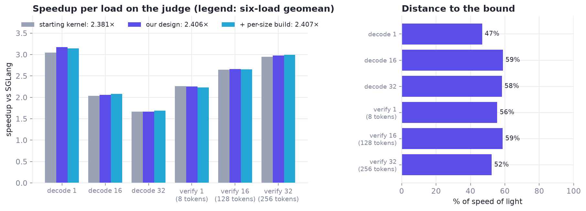
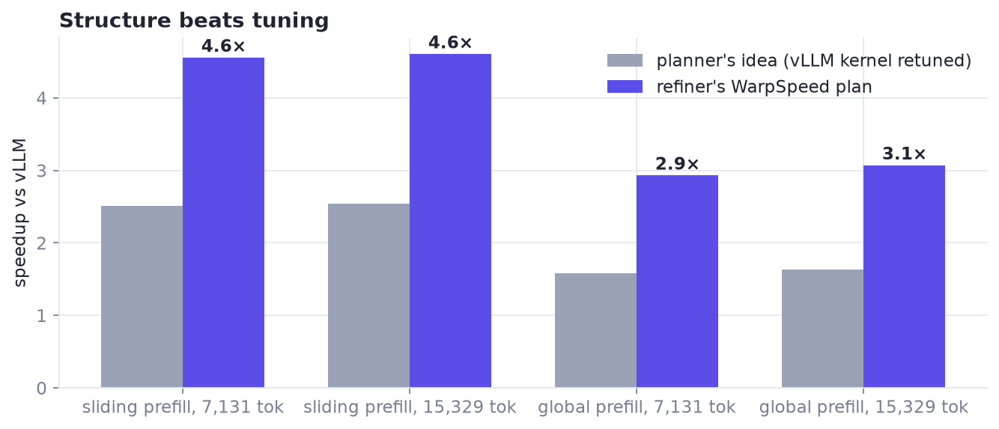
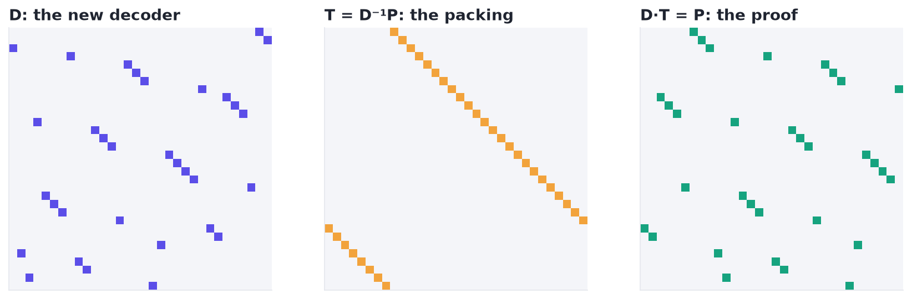
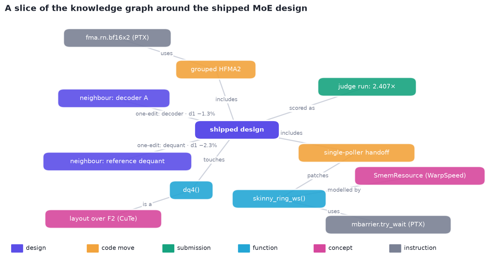
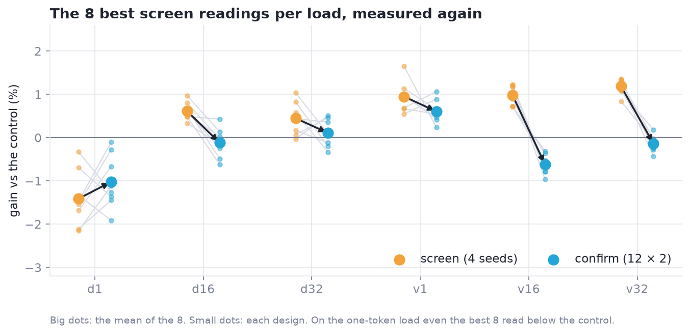
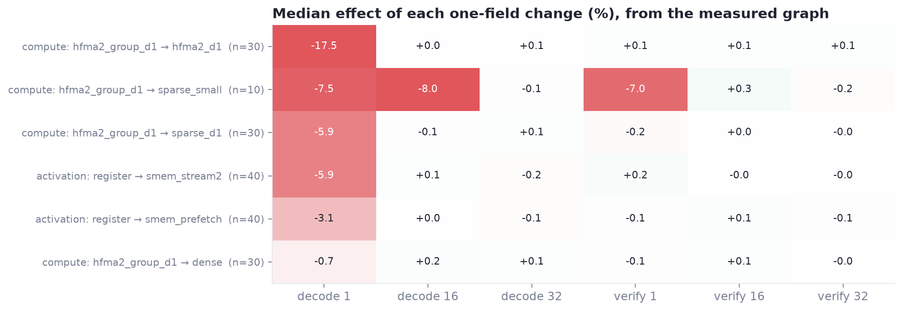
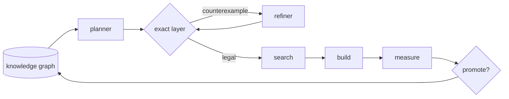

# xArmory // xCalibur

<p align="center">
  
</p>

> xCalibur aims to find **automatable algorithms for solving tractable problems**, on consumer hardware.

<p align="center">
  
  
  
  
</p>

## The story

**It started with a question.** Language models write plausible GPU kernels that rarely beat a vendor's. We asked a
narrower question: can small models *plan* kernels if they speak the language of layouts and warp specialization,
and a checker tells them exactly why a plan can't work? In **TG4DAC**, Gemma 4 31B planned and a WarpSpeed-trained
refiner turned plans into warp-specialized kernels. On attention, a problem held out of its training, the plans beat
vLLM by up to 4.6× on prefill and 1.30× end to end. The lesson: structure beats tuning.
→ [chapter 1](docs/01-tg4dac.md)

**Then a harder test.** The Open Kernel Challenge put an NVFP4 mixture-of-experts layer on one H200 against SGLang's
strong kernels, with a public judge. Here the easy gains were gone, the remaining ones were 0.5–2% per load, and the
noise was just as large. Plans alone could not carry that, so we built the tools they were missing.

**First, a way to know what can exist.** Weight decoders are linear maps over GF(2), which makes them CuTe layouts
over F₂. That turned a messy space into linear algebra: 5,989,005 decoder combinations pruned to 1,816 legal ones in
1.3 ms, each with a proven weight packing. WarpSpeed accounting did the same for warp-specialized plans.
→ [chapter 2](docs/02-exact-layer.md), [chapter 3](docs/03-warpspeed.md)

**Then a way to know what is faster.** A bench that copies the judge, pairs every candidate with the reference, and
counts a gain only when it replicates above the noise. → [chapter 4](docs/04-measurement.md)

**Then a way to choose what to measure.** A learned ranker proposes, the GPU decides, and evidence is pooled per
compiled build. It found two pieces that only win together: +0.4% and +0.9% alone, +3.3% combined.
→ [chapter 5](docs/05-measured-game.md)

**Everything we learned went into knowledge graphs:** every measured design, the kernel's code, the CuTe, PTX and
WarpSpeed references, and what other teams had already measured, in a form a planner can read. The graph even
rediscovered, from data alone, which compiled build each design field reaches. → [chapter 6](docs/06-knowledge-graphs.md)

**And every decision went through an OODA loop:** one run, one written review, then the next decision, with each
lesson turned into an enforced check. It worked because it made orientation explicit, predictions falsifiable and
lessons enforced. → [chapter 7](docs/07-OODA.md)

**The pieces shipped as one file:** **2.407× over SGLang** on the judge, each problem size running its own compiled
build. → [chapter 8](docs/08-shipping.md), [`kernels/moe_w4a16_h200`](kernels/moe_w4a16_h200/)

**Then we put the models back in.** **Anvil**, named for where blades are shaped, is a co-design agent that plans with the TG4DAC models *inside* the exact
layer and the measured search, with the graphs as its memory, on the same GPU it is optimizing.
→ [chapter 9](docs/09-anvil.md)

## Highlights

- **2.407× over SGLang on an NVFP4 MoE, on H200**: one persistent kernel, a GF(2)-searched decoder, a packed-BF16
  one-token path, per-size builds. → [`kernels/moe_w4a16_h200`](kernels/moe_w4a16_h200/)
- **4.6× over vLLM on attention prefill, planned by small models**, 1.30× end-to-end decode.
  → [`kernels/tg4dac_sm120`](kernels/tg4dac_sm120/)
- **Anvil: an agent with on-device search.** → [the formulation](docs/09-anvil.md)
- **Exact before measured**: decoders with proofs, WarpSpeed plans with counterexamples.
  → [notebook 01](notebooks/01_decoders_over_gf2.ipynb), [notebook 02](notebooks/02_warpspeed_plans.ipynb)
- **Statistics for noise as large as the gains**: paired timing, A/A controls, the winner's curse made visible.
  → [notebook 03](notebooks/03_measurement_and_noise.ipynb)
- **Knowledge graphs with evidence**: neighbourhoods, field effects and retrieval over everything measured.
  → [notebook 07](notebooks/07_knowledge_graphs.ipynb)
- **An OODA loop with gates**, and why it worked. → [chapter 7](docs/07-OODA.md)

<table>
  <tr>
    <td width="50%"></td>
    <td width="50%"></td>
  </tr>
  <tr>
    <td></td>
    <td></td>
  </tr>
  <tr>
    <td></td>
    <td></td>
  </tr>
</table>

## Anvil: an agent with on-device search

The whole co-design loop on **one GPU**, the one the kernel runs on:



For each problem size $p$ with incumbent $c_p$, one round is:

$$
x \sim \pi_{\text{plan}}\big(\cdot \mid G,\ \text{retrieve}(G, p),\ M_p\big), \qquad
x' = \pi_{\text{ref}}\big(x, \Delta(x)\big), \qquad
c_p \leftarrow x' \ \text{ if } J_p(x') > (1+m)\,J_p(c_p) \text{ and it holds at confirm,}
$$

where $\Delta$ is the exact layer's diagnostics and $J_p$ a measured, paired speedup, never a prediction. Each size
keeps its own winner, and the winners combine as per-size builds of one kernel. → [chapter 9](docs/09-anvil.md)

## Kernels

| | What | Hardware | Result [measured] |
|---|---|---|---|
| [`moe_w4a16_h200`](kernels/moe_w4a16_h200/) | NVFP4 routed-experts MoE in one persistent kernel | H200 | **2.407×** over SGLang (challenge judge) |
| [`tg4dac_sm120`](kernels/tg4dac_sm120/) | Gemma 4 31B attention from model-written WarpSpeed plans, and the 4-bit MLP + LoRA | RTX PRO 6000 Blackwell | **4.6×** prefill, **1.30×** end-to-end decode over vLLM |

## Notebooks

Each notebook explains one idea in plain words and math, then rebuilds its figures from the measured data in
[`data/`](data/). Rebuild them all with `python notebooks/build.py`.

| Notebook | The idea | Chapter |
|---|---|---|
| [01 · Decoders over GF(2)](notebooks/01_decoders_over_gf2.ipynb) | a decoder is a 32 × 32 bit matrix; a new one comes with its proven packing $T = D^{-1}P$ | 2 |
| [02 · WarpSpeed plans](notebooks/02_warpspeed_plans.ipynb) | squads, rings and phases; the register cap and shared-memory limits, with a counterexample | 3 |
| [03 · Measurement and noise](notebooks/03_measurement_and_noise.ipynb) | the same code measured again, regression to the mean, the winner's curse $\sigma\sqrt{2\ln n}$ | 4 |
| [04 · The MoE on H200](notebooks/04_moe_on_h200.ipynb) | the score, per-load speedups, the distance to the bound, pieces that only win together | 5, 8 |
| [05 · The measured game](notebooks/05_the_measured_game.ipynb) | UCB ranking and evidence pooling find a planted 2% gain among look-alikes | 5 |
| [06 · TG4DAC](notebooks/06_tg4dac.ipynb) | structure beats tuning; why a 4× kernel gives 1.3× end to end | 1 |
| [07 · Knowledge graphs](notebooks/07_knowledge_graphs.ipynb) | neighbourhoods, field effects and retrieval on the real design graph | 6 |

## Install

```bash
pip install -e .                    # the core
pip install -e ".[gpu,search]"      # GPU timing (PyTorch) and the learned ranker (LightGBM)
pip install -e ".[retrieval]"       # embedding search over the knowledge graph (EmbeddingGemma)
```

## A first look

```python
import xcalibur as xc

# A warp-specialized kernel plan: 16 compute warps fed by two loader warps through two shared-memory rings.
plan = xc.plan_of(squads=[("mma", 16), ("w_load", 1), ("x_load", 1)],
                  resources=[("w_ring", 3, 36864, [("w_load", 36864), ("mma", None)]),
                             ("x_ring", 3, 32768, [("x_load", 32768), ("mma", None)])])

r = xc.warpspeed_check(**plan)          # can this plan exist on an H200?
r["pass"]                               # True
r["registers"]["launch_cap"]            # 96 registers per thread
r["smem"]["total_bytes"]                # 208,992 bytes of shared memory, under the 232,448 limit
```

More in [`examples/`](examples/): a decoder search with packing proofs, the search game on a toy problem, and paired
GPU timing.

## What's inside

| Module | Plain meaning | Chapter |
|---|---|---|
| `gf2` | weight decoders as bit maps: check them, compose them, and derive the weight packing each one needs | 2 |
| `warpspeed` | can a warp-specialized plan exist on this GPU? (also usable as a tool by a language model) | 3 |
| `reach` | does a change touch the compiled variant that serves this problem size? | 2 |
| `bench` | time a candidate against a reference, the way the judge does | 4 |
| `stats` | intervals, and the rules for when a measured gain counts | 4 |
| `surrogate` | a learned model that ranks what to measure next | 5 |
| `game` | the search loop: rank, compile, measure, confirm | 5 |
| `graph` | the knowledge graph: every design ever measured, its neighbours, its effects, retrieval | 6 |
| `gates` | the checks before anything goes public | 7 |
| `capture` | prove the shipped file is exactly what was measured | 8 |
| `planner` | the language-model planner and refiner loop (Anvil's proposer) | 9 |

## Data

[`data/`](data/) holds the measurements behind every figure, as plain CSV: the judge's per-load times for each MoE
submission, a 514-design sweep with its 12 × 2 confirms, the decoder × arithmetic interaction, repeat measurements of
identical code, and the TG4DAC kernel and end-to-end results.

## Documentation

[Nine chapters](docs/README.md), one question each, with a shared layout and references; or the
[full report](docs/overview.md) in one document.

## Tests and examples

```bash
python -m pytest tests                   # runs on CPU
python examples/warpspeed_plan.py
python examples/decoder_packing.py
python examples/measured_game_toy.py
python examples/paired_bench.py          # needs a CUDA GPU
```

## License

[Apache 2.0](LICENSE). The MoE kernel builds on Apache 2.0 work by vjeux, alygg77 and Matsvei; their notices are kept
in the file, and our changes are listed in [its README](kernels/moe_w4a16_h200/README.md).

## References

The ones this project leans on most; the chapters cite the rest, and [docs/references.md](docs/references.md) lists
them all.

- [CuTe Layout Representation and Algebra](https://arxiv.org/abs/2603.02298) (Cris Cecka)
- [Categorical Foundations for CuTe Layouts](https://arxiv.org/abs/2601.05972) (Colfax Research)
- [Linear Layouts](https://arxiv.org/abs/2505.23819)
- [A Practical Automatic Polyhedral Parallelizer and Locality Optimizer](https://www.csa.iisc.ac.in/~udayb/publications/uday-pldi08.pdf)
- [NVIDIA CCCL](https://github.com/NVIDIA/cccl) (WarpSpeed: `cub/detail/warpspeed`) and [CUTLASS / CuTe](https://github.com/NVIDIA/cutlass)
- [GPU Mode's KernelBot dataset](https://huggingface.co/datasets/GPUMODE/kernelbot-data)
- [EmbeddingGemma](https://arxiv.org/abs/2509.20354)
