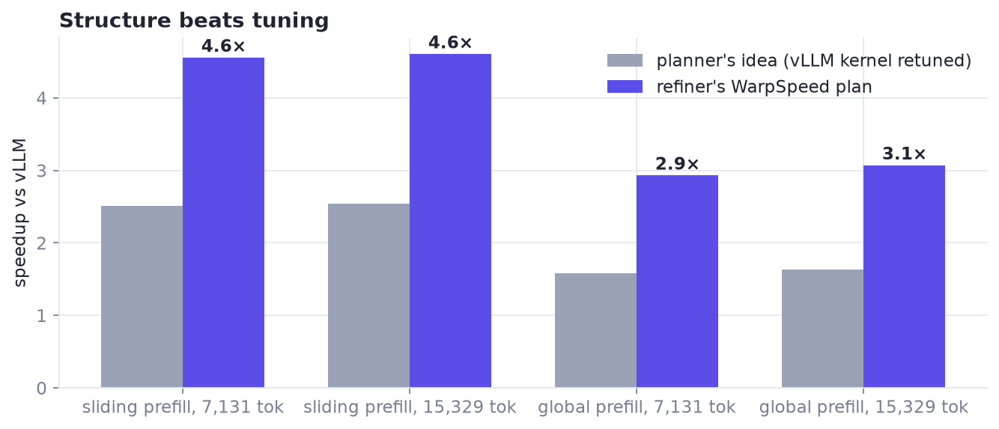
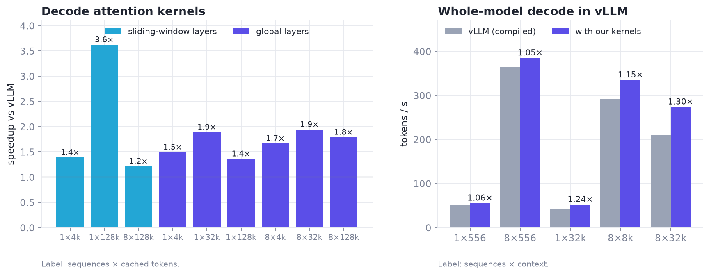

# 1 · The question: TG4DAC

*Can small language models co-design GPU kernels, if they speak the language of layouts and warp specialization?*

> This is where the story starts.

| At a glance | |
|---|---|
| **Problem** | Language models can write kernel code. Can they plan kernel structure that a checker accepts and hardware rewards? |
| **Idea** | Split the work: a planner proposes, a refiner writes a WarpSpeed plan an exact checker accepts, an implementer builds it as written, measurement decides. |
| **What it bought** | 4.6× and 3.1× over vLLM on held-out attention prefill, 1.30× end-to-end decode [M]; and the lesson that structure beats tuning. |
| **Code** | `xcalibur.warpspeed`, `xcalibur.planner`; [`kernels/tg4dac_sm120`](../kernels/tg4dac_sm120/) |
| **Notebook** | [06 · TG4DAC](../notebooks/06_tg4dac.ipynb) |

---

## 1. The original question

xCalibur started with one question:

> Can language models, trained on the vocabulary of layout algebra and a dataset of GPU kernel implementations,
> implement a mixture-of-experts operator that matches vendor performance on consumer hardware?

The first work was by hand: BF16 MoE kernels for consumer GPUs across three generations, written to learn where the
time goes. It made two things clear. Kernel design is mostly a sequence of exact decisions (layouts, ownership,
staging) followed by measurement. And the decisions that matter are *structural*, not tuning knobs. That pointed
at a different question: can a model make the structural decisions, if a tool checks them?

## 2. TG4DAC: small models co-designing kernels

TG4DAC tested that question on one RTX PRO 6000 Blackwell (SM120), with Gemma 4 models as designers and a frontier
coding model as the implementer.

### 2.1 The roles

| Role | Model | Job |
|---|---|---|
| **Planner** | Gemma 4 31B with a planning adapter | decompose the operator: fusion, tiling, ownership and layout expressions, an initial schedule |
| **Refiner** | Gemma 4 31B with a second adapter | revise the plan against the hardware: squads, staged buffers, register budgets |
| **Implementer** | a frontier coding model | write the kernels from the plans and measure them against the starting kernel in the same run |

The roles stayed separate on purpose: the ideas come from the planner, the warp structure from the refiner, and the
code and the numbers from the implementer. Every result records where it came from.

### 2.2 Code graphs and executable algebra

Planning ran over **code graphs**, not just text:

- a **source graph** of the layout library (PyCuTe): modules, symbols, definitions, examples and tests;
- an **API dependency graph**: which function's output can bind which function's input, checked by executing it;
- the **co-design graph**: the physical plan itself, with nodes for computation, movement, storage and synchronization.

EmbeddingGemma indexed the source and found the right entry points. The planner could also **run layout algebra
while it planned**. For example, an ownership map *O* (which warp, lane and slot holds which element) composed with a
storage layout *L* gives the address map *A = L ∘ O*, and the planner checked it by running it. A model that can run
its claims makes fewer wrong ones.

### 2.3 The MLP round: a strong starting point leaves nothing to win

The first full round targeted a dense 4-bit MLP with a rank-16 LoRA adapter, starting from hand-written kernels that
already ran at about 80% of the matrix units' peak. None of the models' proposals beat them [M]:
- deeper prefetch was slower;
- smaller tiles were slower;
- a dequantize-ahead design was exact but 9–21% slower, because it moved through shared memory work the original kept
  in registers.

The round still produced two durable things:
- **A measured register rule** for this GPU: 65,536 / (128 × ⌈warps/4⌉) registers per thread at launch. It explained
  why every 9-warp kernel was capped at 168 registers and spilled.
- **A real end-to-end gain** from a hand-written GEMV kernel inside vLLM: 1.07–1.09× decode throughput [M].

### 2.4 The attention round: a checker and a plan language

For the second round we trained the refiner to write **WarpSpeed** plans (NVIDIA CCCL's warp-specialization model: squads,
staged shared-memory resources, phases, barriers) and gave it a typed **`warpspeed_check`** tool that returns either
every derived number or the first violation.
- **Training data:** 30 worked examples with real tool runs, from CCCL's own WarpSpeed kernel, our MLP kernels,
  FlashInfer's warp-specialized MLP and small drills.
- **Held out:** attention was deliberately left out of training, so the attention results are a test on unseen work.

Results on Gemma 4 attention, each timed against vLLM's kernel [[Kwon 2023](#kwon-2023)] in the same run [M]:

| Workload | vLLM | Refiner's WarpSpeed plan | Speedup |
|---|---|---|---|
| sliding-window prefill, 15k tokens | 9.99 ms | 2.17 ms | **4.6×** |
| global prefill, 15k tokens | 109.3 ms | 35.6 ms | **3.1×** |
| sliding decode, 32k–128k context | 62.3 µs | 17.2 µs | **3.6×** |
| whole-model decode in vLLM, 8 × 32k | 209.8 tok/s | 273.7 tok/s | **1.30×** |

What the models did:
- The planner found the three real problems by itself: decode work spread over a whole sequence when only the window
  matters, a V-only cache (K can be rebuilt from V), and prefill tiles too small for compute-heavy work.
- Two of its prefill plans did not fit in shared memory. The refiner fixed both, and its plans with a real producer /
  consumer split became the fastest kernels.
- Over 16 episodes, the refiner ended with a checker-passing plan in 14, and fixed at least one checker error in 10.

Every decode step also pays about 18 ms that attention doesn't touch, so with attention a fraction $a$ of the step,
a kernel speedup $k$ gives the end-to-end speedup $1 / \big((1-a) + a/k\big)$: small at short context, growing with
context (1.06× at 1 × 556 tokens, 1.30× at 8 × 32k) [M]. See [notebook 06](../notebooks/06_tg4dac.ipynb).

### 2.5 What TG4DAC taught

1. **Structure beats tuning.** Retuning the baseline's tiles gave 1.5–2.4×; the refiner's warp-specialized structure
   gave 2.9–4.6×.
2. **A checker turns guesses into fixes.** The models' own register and shared-memory estimates were often wrong; with
   a tool that says exactly what is over budget, the refiner corrected real errors.
3. **The starting point decides the headroom.** Near-peak kernels left nothing to win; a generic fallback kernel left
   a lot.
4. **Accounting is not compilation.** One plan passed the checker and still spilled once compiled. Measurement stays the
   last word.

## 3. Why the Open Kernel Challenge was the next test

TG4DAC left an obvious doubt: its biggest wins came against a generic fallback kernel, on our own bench. The honest
next test needed four things TG4DAC didn't have:

| TG4DAC | What we needed | The Open Kernel Challenge |
|---|---|---|
| our own bench | a **public judge**, reruns on held-out data | timed against SGLang's kernel; final standings from medians of reruns |
| a consumer Blackwell GPU | **datacenter hardware** | one NVIDIA H200 |
| attention, after an MLP | **the operator xCalibur started with** | a 4-bit (NVFP4) routed mixture-of-experts layer |
| a weak starting point | **a strong baseline with no easy headroom** | a production engine's tuned kernels |

It was the original question, on a stage where nobody's numbers could be wishful.

## 4. What carried over, and what we had to add

**Carried over from TG4DAC:**
- the roles: planner, refiner against an exact checker, implementer and measurement;
- WarpSpeed as the plan language, and the typed checker (ported to the H200's limits);
- code graphs and EmbeddingGemma retrieval, extended to every design we measured;
- implementing plans as written and timing them in the same run as their reference.

**Added, because the baseline was strong and the noise was large:**
- an **exact design grammar**: decoder bit maps over GF(2) as CuTe layouts, WarpSpeed-checked contracts
  ([chapter 2](02-exact-layer.md));
- a **measured search game** with a learned ranker, which found most of the gains ([chapter 5](05-measured-game.md));
- a **judge-faithful bench** and statistics for noise as large as the gains ([chapter 4](04-measurement.md));
- the **reach check**, so no plan is measured unless it can change its target ([chapter 2](02-exact-layer.md));
- **one plan per problem size**, and per-size builds to combine the winners ([chapter 9](09-anvil.md),
  [chapter 8](08-shipping.md));
- an **operating loop** with written reviews and hard release gates ([chapter 7](07-OODA.md)).

## 5. What the comparison says, and the next step

Against the challenge's strong MoE baseline, the gains that held on the judge came from the exact layer plus measured
search [M]. TG4DAC's models did their best work where the space was open and structure was missing. The next step
puts both together: **Anvil**, an agent that plans with the TG4DAC models *inside* the exact layer and the measured search,
on the same GPU it is optimizing ([chapter 9](09-anvil.md)).

## References

- **[Kwon 2023]** W. Kwon et al. *Efficient Memory Management for Large Language Model Serving with PagedAttention* (vLLM). SOSP 2023. The TG4DAC baseline. [link](https://arxiv.org/abs/2309.06180)
- **[CCCL]** NVIDIA. *CUDA Core Compute Libraries (CCCL)*, WarpSpeed in `cub/detail/warpspeed`. The plan language and our checker's semantics. [link](https://github.com/NVIDIA/cccl)
- **[CUTLASS]** NVIDIA. *CUTLASS and CuTe*, including PyCuTe. Layout algebra in the planner and the decoder layouts. [link](https://github.com/NVIDIA/cutlass)
- **[Cecka 2026]** C. Cecka. *CuTe Layout Representation and Algebra.* arXiv:2603.02298, 2026. The CuTe graph and the decoder-as-layout view. [link](https://arxiv.org/abs/2603.02298)
- **[FlashInfer]** FlashInfer. Its warp-specialized MLP was one of the refiner's training examples. [link](https://github.com/flashinfer-ai/flashinfer)

Full list: [references.md](references.md).

---

[← Contents](README.md) · [Contents](README.md) · [2 · The exact layer →](02-exact-layer.md)
