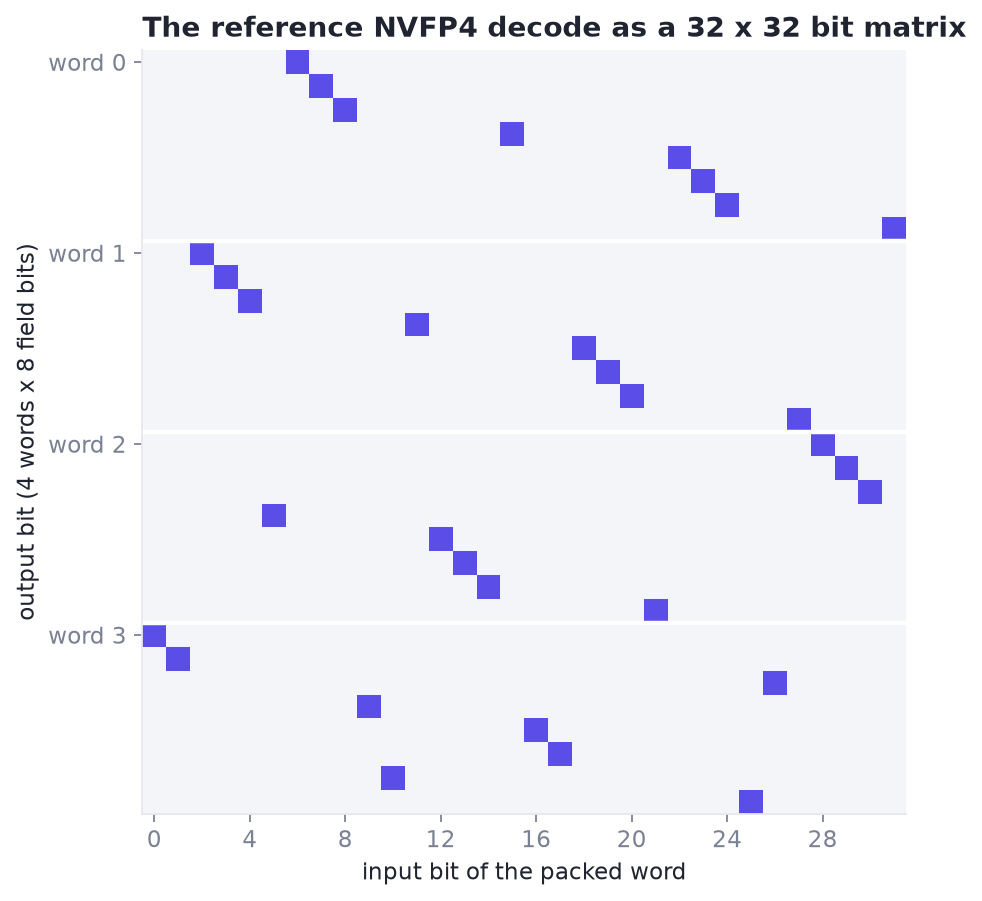
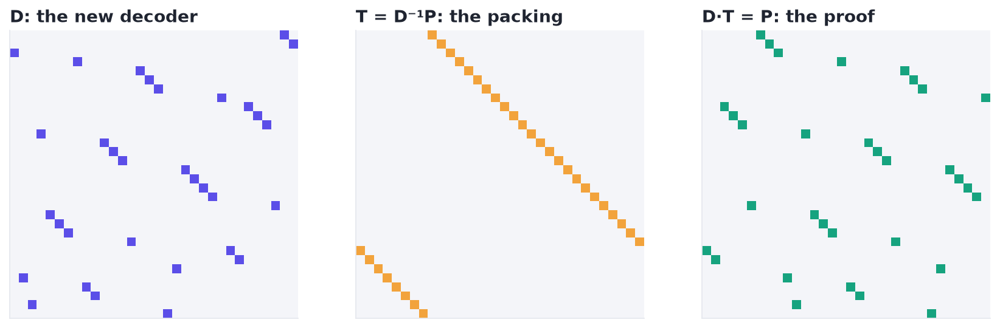
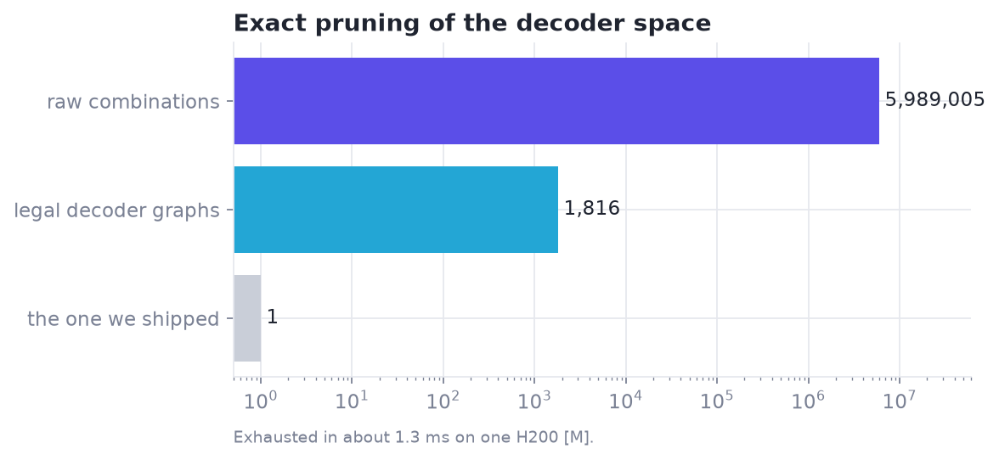

# 2 · What can exist: the exact layer

*Which kernels are legal, and which changes can matter, before anything compiles?*

> **Previously.** TG4DAC's models did their best work when a checker told them precisely why a plan could not work. Here the checker grows into an exact layer for a whole design space.

| At a glance | |
|---|---|
| **Problem** | Most candidate kernels can't exist, or can't change the size being optimized. Measuring them wastes the scarcest resource. |
| **Idea** | Decide legality exactly: weight decoders as linear maps over GF(2) (CuTe layouts over F₂), WarpSpeed accounting, a reach map, compile and SASS identity. |
| **What it bought** | 5,989,005 decoder combinations pruned to 1,816 legal ones in about 1.3 ms, each with a proven packing; the decoder behind the +3.3% one-token gain [M]. |
| **Code** | `xcalibur.gf2`, `xcalibur.warpspeed`, `xcalibur.reach` |
| **Notebook** | [01 · Decoders over GF(2)](../notebooks/01_decoders_over_gf2.ipynb) |

---

The cheapest kernel to reject is the one you never build. The exact layer is a set of checkers, each answering one
question exactly. Together they shrink the space a search must measure by orders of magnitude, and they give
planners precise counterexamples instead of vague failures.

| Checker | Question | Module |
|---|---|---|
| Decoder maps | Is this bit recipe a correct decoder, and how must the weights be packed for it? | `xcalibur.gf2` |
| WarpSpeed accounting | Can this warp-specialized CTA plan exist on this GPU? | `xcalibur.warpspeed` |
| Reach | Does this edit change the build that serves this problem size at all? | `xcalibur.reach` |
| Compile and SASS | Does it compile, and is its code different from its parent's? | your compiler + `xcalibur.capture` |

---

## 1. Decoder maps over GF(2), as CuTe layouts

Packed low-bit weights (for example NVFP4: 4-bit codes plus scales) are decoded with bit operations before the math.
Every decoder that only moves and selects bits is a **linear map over GF(2)** from a 32-bit packed word to its output
bit fields. That turns a messy design space into linear algebra:

- a decoder is a tuple of rows, one per output bit; row *i* is the mask of input bits XOR-ed into output bit *i*;
- two decoders are equal if their maps are equal, which comparing the 32 basis images proves for all 2³² words;
- for an invertible decoder *D* and the reference decode *P*, the weight packing that makes *D* correct is exactly
  **T = D⁻¹ P**. A new decoder therefore comes with a proven lossless repacking for `prepare()`.

In CuTe terms [[Cecka 2026](#cecka-2026); [Colfax 2026](#colfax-2026)] a decoder is `Layout((2,)*32, F2-strides)`: a 32-mode layout over GF(2) whose stride for input bit *i*
is the image of basis vector *eᵢ*. Evaluating the layout at a word is applying the decoder, and composing layouts is
composing decoders. Triton's linear layouts use the same F₂ view for data layouts [[Zhou 2025](#zhou-2025)].

**Enumeration.** A grammar of partial decoders ("atoms", each producing some output fields) defines the space. Pairs
of atoms that stay linearly independent are compatible; a pairwise-compatibility bitset prunes the product before any
combination is built, and joins of compatible atoms that reach full rank are the legal decoders. In our production
grammar this reduced 5,989,005 raw combinations to 1,816 legal decoder graphs in about 1.3 ms on an H200 [M].

**Why it mattered.** The decoder was a real performance lever: one decoder graph, combined with a different dequant
arithmetic, gave the largest late gain on the one-token load (+3.3%, where each piece alone gave +0.4% and +0.9%) [M].
That combination could only be searched because the space of legal decoders was finite, exact and enumerable.

```python
import xcalibur as xc
P = reference_rows                      # the reference decode, as GF(2) rows
D = candidate_rows                      # a new decoder
T = xc.packing_transform(D, P)          # proven: D(T(w)) == P(w) for every word w
layout = xc.as_cute_layout(D)           # the same map as a CuTe layout (needs pycute)
```

**In pictures.** The reference NVFP4 decode as a bit matrix, $y = Dw$ over GF(2) with $y_i = \bigoplus_j D_{ij} w_j$:



A new decoder $D$, its packing $T = D^{-1}P$, and the proof $DT = P$ (checked on the 32 basis words, so for all $2^{32}$):





Worked through in [notebook 01](../notebooks/01_decoders_over_gf2.ipynb).

## 2. WarpSpeed accounting

WarpSpeed describes a warp-specialized kernel as squads, staged shared-memory resources, phases and owners. Our
checker verifies a plan against WarpSpeed's semantics and the GPU's limits, and returns either every derived quantity
or the first violation. See [chapter 3](03-warpspeed.md) for the full treatment. In the exact layer it is used to:

- enumerate the legal ownership × pipeline contracts of a large-batch build (1,062 survive) [D];
- reject search candidates whose plan cannot exist before they are compiled;
- give a planner typed counterexamples ("319,632 B of shared memory exceed 232,448 B per CTA").

## 3. Reach: does an edit touch the build that serves this problem?

A kernel that ships several compiled builds and picks one by problem size *M* raises an exact question: does a design
change the build serving load *L* at all? Declare which fields each build reads, and which field sets the size cutoff
between builds, and the answer is a lookup (`xcalibur.ReachMap`):

```python
rm = xc.ReachMap(loads={"m1": 1, "m16": 16, "m32": 32}, cutoff_field="cutoff",
                 fields={"large": ("ownership", "pipeline", "workmap"), "m1": ("compute", "activation"), "all": ("decoder",)})
rm.reaches("m16", candidate, incumbent)     # False -> any measured difference on m16 is noise
rm.identity("m16", candidate)               # designs with equal identity are the same kernel for m16
```

Derive the map from the lowering (which field is read when compiling which build), then **cross-check it with
compiled SASS**: designs with the same identity for a load must produce identical code for its build. That check
caught an error in our first map (a routing field we thought reached the large build only moves the cutoff).

**Why it mattered.** Before the check, 8 of 9 measurements in one planner round timed designs whose target build was
byte-for-byte unchanged, and those "moved" their load by −1.4% to +1.4% [M]: pure noise that looked like progress.
With the check, no-op plans are rejected before measuring, and equal identities pool their measurements.

## 4. Compile and SASS as exact gates

Compilation is itself a checker. Compile candidates on CPU first (cheap and parallel):

- a compile error is an exact contradiction, recorded, never retried;
- a build whose SASS equals its parent's is an exact no-op, recorded, never timed;
- the compiled SASS gives exact features (instruction counts by opcode, registers, spills) for the ranker.

Over 325 archived designs ingested as starting points, this caught 38 no-ops and 18 contradictions before any GPU
time was spent [M].

## References

- <a id="cecka-2026"></a>**[Cecka 2026]** C. Cecka. *CuTe Layout Representation and Algebra.* arXiv:2603.02298, 2026. The CuTe graph and the decoder-as-layout view. [link](https://arxiv.org/abs/2603.02298)
- <a id="colfax-2026"></a>**[Colfax 2026]** Colfax Research. *Categorical Foundations for CuTe Layouts.* arXiv:2601.05972, 2026. Also turned into a graph for retrieval. [link](https://arxiv.org/abs/2601.05972)
- <a id="zhou-2025"></a>**[Zhou 2025]** K. Zhou et al. *Linear Layouts: Robust Code Generation of Efficient Tensor Computation Using F₂.* arXiv:2505.23819, 2025. The same F₂ view, for data layouts. [link](https://arxiv.org/abs/2505.23819)
- <a id="bondhugula-2008"></a>**[Bondhugula 2008]** U. Bondhugula et al. *A Practical Automatic Polyhedral Parallelizer and Locality Optimizer.* PLDI 2008. The formulation behind our design enumeration. [link](https://www.csa.iisc.ac.in/~udayb/publications/uday-pldi08.pdf)
- <a id="cutlass"></a>**[CUTLASS]** NVIDIA. *CUTLASS and CuTe*, including PyCuTe. Layout algebra in the planner and the decoder layouts. [link](https://github.com/NVIDIA/cutlass)

Full list: [references.md](references.md).

---

[← 1 · TG4DAC](01-tg4dac.md) · [Contents](README.md) · [3 · WarpSpeed →](03-warpspeed.md)
