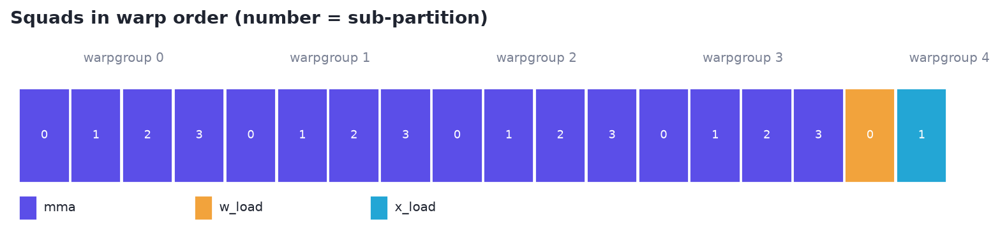
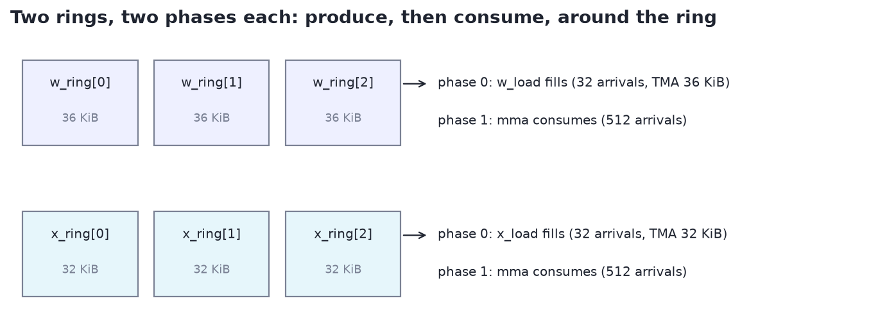
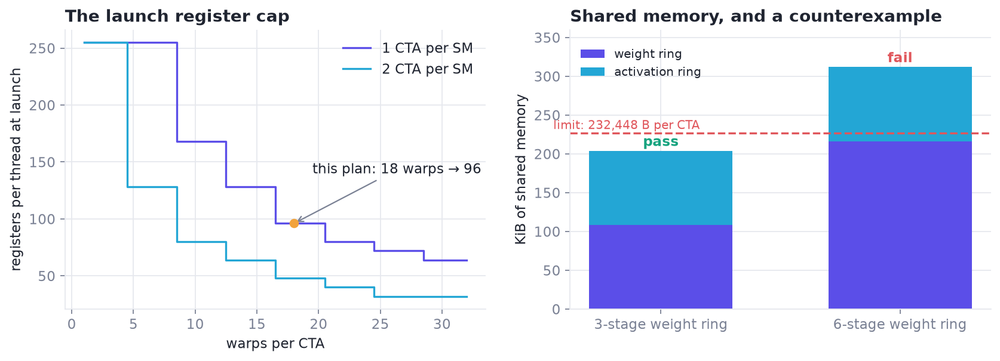

# 3 · Warp specialization you can check: WarpSpeed

*How do you describe a warp-specialized kernel so that a model can write it and a checker can prove it fits?*

> **Previously.** The exact layer includes WarpSpeed accounting. It gets its own chapter because it is also the language the models plan in.

| At a glance | |
|---|---|
| **Problem** | Warp-specialized kernels couple warps, rings, barriers, registers and shared memory; mistakes surface as hangs, spills or silent serialization. |
| **Idea** | Write kernels as squads, staged resources and phases (CCCL WarpSpeed) and derive every quantity exactly from the plan. |
| **What it bought** | A plan language a 31B model can write, exact legality with counterexamples it can repair, and features for the learned search. |
| **Code** | `xcalibur.warpspeed` (`warpspeed_check`, `plan_of`, a tool schema for models) |
| **Notebook** | [02 · WarpSpeed plans](../notebooks/02_warpspeed_plans.ipynb) |

---

## Summary

We used WarpSpeed (NVIDIA CCCL, `cub/detail/warpspeed`) [[CCCL](#cccl)] as the shared vocabulary for an automated kernel co-design
system: language models plan kernels, an exact layer checks them, and an H200 measures them. WarpSpeed did five
separate jobs in that system:

| # | Role | Where | What it gave us |
|---|---|---|---|
| 1 | **A language for model-written plans** | TG4DAC refiner, Anvil's refiner | Plans a 31B model can write, a checker can verify, and an engineer can implement directly |
| 2 | **Exact legality for a design grammar** | design-grammar contracts | 1,062 legal warp-specialization contracts for the MoE's large-batch build, enumerated before any compile [D] |
| 3 | **Admissibility and features for a learned search** | the co-design game's sigma layer | Every candidate kernel rewritten as a WarpSpeed plan; illegal ones pruned, derived quantities used as ranking features |
| 4 | **A way to reason about synchronization** | the FF1→FF2 handoff | "Who owns this wait?" turned into a one-owner-per-CTA handoff, **+2.2%** on the one-token MoE load [M] |
| 5 | **Counterexamples a model can act on** | checker → refiner loop | The first violation comes back as a typed counterexample, and the refiner repairs the plan |

The shared idea is that WarpSpeed makes a warp-specialized kernel *explicit and finite*: squads, resources, stages,
phases and owners. Everything explicit can be checked. Everything finite can be enumerated. Both are what automation
needs.

---

## 1. What we used

**The model.** A CTA is split into **squads**, contiguous ranges of warps with one role each. Squads exchange data
through **resources**, shared-memory rings of `stages × stride_bytes`. Each resource has 2–4 **phases**, and each phase
has **owner** squads. Every phase owns one mbarrier per stage, whose arrival count is the owners' thread count. A TMA
phase adds expected transaction bytes through its squad's leader thread. Acquiring phase *p* waits on phase *p−1*'s
barrier, so the phases form a ring.

**The checker.** We wrote `warpspeed_check`, a typed CPU tool that follows these semantics (pinned to a CCCL release) and adds measured per-architecture facts. One version targets SM120 (TG4DAC) and one targets H200 SM90a
(this work). Each check:
- places squads in warp order;
- derives barrier arrival counts and transaction bytes;
- applies the launch register cap: 65,536 / (128 × ⌈warps/4⌉ × CTAs per SM), floored to 8, at most 255;
- checks `setmaxnreg` legality: every warp in a warpgroup requests the same value, and the total fits the launch pool;
- checks per-sub-partition warp placement;
- lays out shared memory exactly (buffers in declaration order, then the barrier arrays) against the CTA and SM limits;
- enforces WarpSpeed's own limits (at most 10 resources, 2–4 phases each).

It returns **pass plus every derived number**, or **the first violation as a counterexample**. It's accounting, not a
compiler or a timer. Compilation and measurement remain the gates for registers actually allocated, spills and speed.

**Example: the MoE's large-batch build, as checked [D].**

```json
{"squads":    [{"name": "mma", "warps": 16}, {"name": "w_load", "warps": 1}, {"name": "x_load", "warps": 1}],
 "resources": [{"name": "w_ring", "stages": 3, "stride_bytes": 36864,
                "phases": [{"owners": ["w_load"], "tx_bytes": 36864}, {"owners": ["mma"]}]},
               {"name": "x_ring", "stages": 3, "stride_bytes": 32768,
                "phases": [{"owners": ["x_load"], "tx_bytes": 32768}, {"owners": ["mma"]}]}]}
```

```text
pass · 18 warps, 576 threads, 5 warpgroups · launch register cap 96 · 12 mbarriers
mma owns w_ring:1, x_ring:1 (warps 0–15, 4 per sub-partition) · w_load owns w_ring:0 · x_load owns x_ring:0
shared memory 208,992 B of 232,448 B per CTA · 1 CTA per SM
```

The same plan with a 6-stage weight ring returns a counterexample:

```text
smem_cta: 319,632 B of shared memory exceed 232,448 B per CTA
smem_sm:  1 CTA × (319,632 + 1,024) B exceed 233,472 B per SM
```

---

**The accounting, exactly.** For a plan with squads $s$ and resources $r$ (stages, stride, phases):

$$
\text{arrivals}(\text{phase}) = 32\!\!\sum_{s \in \text{owners}}\!\! \text{warps}_s, \qquad
\text{smem} = \sum_r \text{stages}_r\,\text{stride}_r + 8\sum_r \text{phases}_r\,\text{stages}_r,
$$

$$
\text{register cap} = \min\!\Big(255,\ \Big\lfloor \tfrac{65536}{128\,\lceil \text{warps}/4\rceil\,\text{CTAs per SM}} \Big\rfloor_8\Big).
$$







Worked through in [notebook 02](../notebooks/02_warpspeed_plans.ipynb).

## 2. Five roles

### 2.1 A language for model-written plans (TG4DAC → Anvil)

In TG4DAC, a Gemma 4 31B **refiner** turns a planner's rough proposal into a WarpSpeed plan: squads, staged buffers
with phases, barrier counts and register budgets. It checks each plan with `warpspeed_check` before answering. It was
trained on 30 worked examples with real tool runs, including **CCCL's own WarpSpeed scan kernel**, and attention was held
out. On that held-out problem (Gemma 4 attention on an RTX PRO 6000 Blackwell), the refiner's plans, implemented as
written, were the fastest kernels we measured [M]:
- 4.6× vLLM on sliding-window prefill and 3.1× on global prefill;
- up to 3.6× on decode;
- 1.30× end-to-end decode at 8 × 32k context.

**Why WarpSpeed worked as the language:** a plan in WarpSpeed terms is complete enough to implement and small enough to
check. The refiner doesn't have to invent a notation for "who waits on whom". The notation is given, and every number in
it is either chosen (stages, stride, warps) or derived (barrier counts, transaction bytes, register caps).

In Anvil, on the H200 MoE kernel, the same refiner repairs plans against exact diagnostics, with retrieval over a 154-node
graph of CCCL WarpSpeed structs and functions. Plans come back legal and implementable [M].

### 2.2 Exact legality for a design grammar

The MoE's large-batch build is a warp-specialized WGMMA kernel: MMA warpgroups, a weight-producer warp and an
activation-producer warp, connected by TMA-fed rings. our **design grammar** writes each candidate ownership × pipeline
choice as a WarpSpeed plan. It's checked together with the kernel's exact shared-memory ABI (the frozen `Smem` struct,
laid out the way the compiler lays it out) and an exhaustive check of ring segment lengths and phases that rejects early
reuse or release. **1,062 contracts** pass [D]. Each one can be lowered automatically to a complete kernel and measured.

**Why this mattered:** the large-batch build's design space became a finite, legal list. The search spends GPU time only
on kernels that can exist, and a learned ranker can be trained over a space with no holes.

### 2.3 Admissibility and features for a learned search (the co-design game)

The co-design game explores compile-time variants of each build with a LightGBM bootstrap ensemble and an upper
confidence bound. Its **sigma layer** rewrites every candidate node as a WarpSpeed plan of the parent kernel's structure
and runs `warpspeed_check`:

- **Admissibility.** A node whose plan fails (stage count, barrier arity, register cap, shared memory) is never compiled.
- **Features.** The plan's derived quantities, namely the register cap, warps per scheduler, bytes in flight per SM and
  a stream-rate bound computed from bytes in flight, are inputs to the ranker. They're exact, cheap, and available
  before compiling.

**Why this mattered:** the ranker learns from quantities with physical meaning instead of only from knob values, and it
never wastes a slot on a node that can't be built.

### 2.4 A way to reason about synchronization (the handoff)

In the one-token MoE build, the down projection (FF2) waits for the gate/up stage (FF1) across CTAs, and eight warps
per CTA were each polling the same readiness flag. Asked as a WarpSpeed question, *which squad owns this phase?*, the
answer is one owner: a single elected poller per CTA, with the rest of the squad released through a named barrier.
Measured on the parent kernel, that alone gave **+2.2%** on the one-token load. Stacked on our best design, it was part of
the submission the judge scored at **2.4059×**, up from 2.3620× [M]. It's now a reusable library move.

**Why this mattered:** the phase-ownership framing turned a vague "too much spinning" into a specific, testable change.

### 2.5 Counterexamples a model can act on

Every check returns either pass with derived numbers, or the first violation with its code and the offending quantity.
That's the form a language model repairs best.
- **In TG4DAC,** the refiner was trained with executed checker feedback.
- **In Anvil,** the refiner gets the exact diagnostics, including WarpSpeed violations, and returns a repaired plan, which
  is checked again.

**Why this mattered:** counterexamples close the loop without a human. "Phase 1 of `w_ring` has no owner" or "319,632 B
exceed 232,448 B" translates directly into an edit.

---

## 3. What made WarpSpeed a good fit for automation

- **Ownership is explicit.** Every arrival has an owner, so barrier counts are derived rather than chosen. That removes
  a whole class of free parameters (and bugs).
- **The structure is finite.** At most 10 resources, 2–4 phases each, a ring per resource. A space with these bounds
  can be enumerated, which is what made 1,062 exact contracts possible.
- **It maps one-to-one onto the hardware's primitives.** Phases are mbarriers, TMA phases are expect-tx plus
  `cp.async.bulk`, and squads are warp ranges. A checked plan reads straight into CUDA.
- **It separates the plan from the code.** The same plan can be checked by a tool, written by a model and implemented by
  an engineer, so all three work from one description.

---

## 4. Where we extended it

These are the places where we built our own pieces on top of WarpSpeed's model. Each is a candidate for the library.

- **Per-architecture resource tables.** Register caps, `setmaxnreg` rules and shared-memory limits per CTA and per SM
  differ by architecture. We measured and encoded them for SM120 and H200.
- **Cross-CTA phases.** The FF1→FF2 handoff is a phase whose producers and consumers are in different CTAs. We reasoned
  about it in WarpSpeed terms, but the plan object itself is per CTA.
- **Derived throughput quantities.** Bytes in flight per SM, and a stream-rate bound from them, were useful ranking
  features. We computed them next to the plan, not as part of it.
- **A plan→code skeleton.** Plans were implemented by hand (TG4DAC) or by the design grammar's constructors. A generated skeleton
  (squads, rings, barriers, TMA issue, consumer loop) from a checked plan would remove a large share of hand work.

---

## 5. Suggestions

If WarpSpeed offered these, an automated co-design loop could use it directly:

1. **A machine-readable plan format and a reference checker** in CCCL: the plan as JSON or a C++ constexpr object; the
   checker returning derived quantities and typed counterexamples.
2. **Architecture tables** for Hopper and Blackwell (register caps, `setmaxnreg` rules, shared-memory limits), owned by
   the library.
3. **Grid-level phases** for cross-CTA producer/consumer handoffs, with explicit ownership.
4. **Derived pipeline quantities** exposed from a plan: bytes in flight, barrier arity, per-squad register pool.
5. **A skeleton generator** from a checked plan to compilable CUDA, so a model's plan becomes code with no hand
   translation.

---

## Appendix: interface of our checker

```text
warpspeed_check(squads, resources, ctas_per_sm=1, extra_smem_bytes=0)
  squads:    [{name, warps, regs?, regs_needed?}]          contiguous warp ranges, declaration order
  resources: [{name, stages, stride_bytes, align?, phases: [{owners: [squad], tx_bytes?}]}]
returns:
  pass:   cta (warps, threads, warpgroups), registers (launch cap, pool, setmaxnreg), squads (warp range,
          sub-partition placement, owned phases), mbarriers, smem (layout total vs CTA / SM limits), limits
  fail:   violations [{code, message, where}] and the first one as the counterexample
```

Code: `xcalibur/warpspeed.py` (the checker), `xcalibur/game.py` (admissibility and features in the measured game),
`xcalibur/planner.py` (the refiner loop). The full system is described in `docs/overview.md`.

## References

- <a id="cccl"></a>**[CCCL]** NVIDIA. *CUDA Core Compute Libraries (CCCL)*, WarpSpeed in `cub/detail/warpspeed`. The plan language and our checker's semantics. [link](https://github.com/NVIDIA/cccl)
- <a id="ptx"></a>**[PTX]** NVIDIA. *Parallel Thread Execution ISA.* The PTX graph for retrieval. [link](https://docs.nvidia.com/cuda/parallel-thread-execution/)

Full list: [references.md](references.md).

---

[← 2 · The exact layer](02-exact-layer.md) · [Contents](README.md) · [4 · Measurement →](04-measurement.md)
