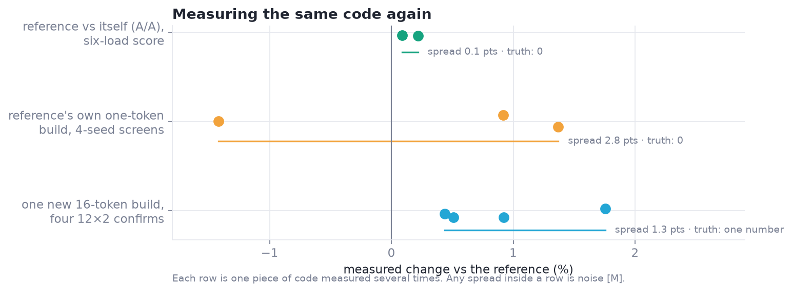
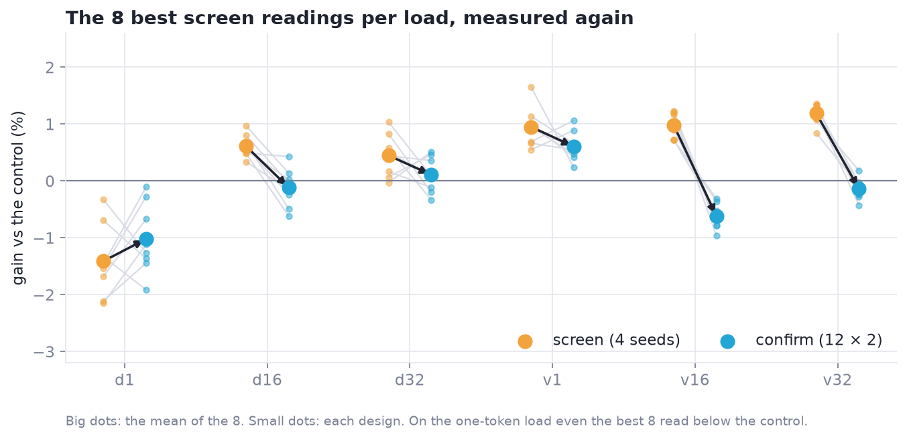
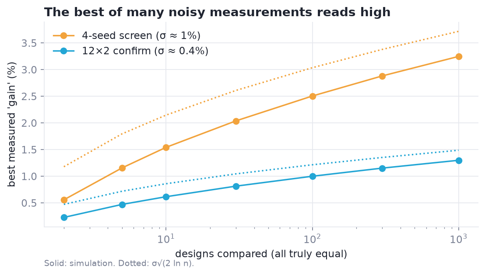

# 4 · What is faster: measurement

*How do you tell a 1% gain from noise, when the noise is 1%?*

> **Previously.** The exact layer says what can exist. Among the kernels that can, only a measurement can say which is faster.

| At a glance | |
|---|---|
| **Problem** | Late gains are 0.5–2% per load, the same size as run-to-run noise, and a false win costs a scarce judged run. |
| **Idea** | Copy the judge's timing method, pair every candidate with the reference, measure the noise with A/A runs, and count only replicated gains. |
| **What it bought** | A bench that tracks the judge, screen leaders caught regressing before they cost a run, and a binding rule that separates a 0.9% effect from noise [M]. |
| **Code** | `xcalibur.bench`, `xcalibur.stats` |
| **Notebook** | [03 · Measurement and noise](../notebooks/03_measurement_and_noise.ipynb) |

---

Every other layer proposes or prunes. Measurement is the one layer allowed to say "faster". Most of our early mistakes
were measurement mistakes, so this layer is built to be checked.

---

## 1. Copy the judge's method

`xcalibur.Bench` times a candidate against a reference the way kernel judges typically do:

| Piece | Why |
|---|---|
| **CUDA graphs** | each callable is captured once and replayed, so launch overhead is equal for both |
| **Cold L2 by a read** | a large buffer (256 MiB) is *read* before every replay |
| **ABBA pairs** | candidate and reference alternate, so clock and temperature drift cancel in the ratio |
| **Null replay subtracted** | replaying an empty graph costs about 16–19 µs on our H200 setup; subtract it, or it dilutes every ratio [M] |
| **A/A control** | the reference against itself, every session: the noise floor to judge a gain against |

```python
bench = xc.Bench()
r = bench.paired(candidate=lambda: my_kernel(x, w), reference=lambda: F.linear(x, w), pairs=30)
r["ratio"], r["ci"], r["candidate_us"], r["reference_us"]
```

**Calibrate before trusting.** Run a file the judge has already timed, and compare. Our projection bench's cuBLAS
times matched the judge's SGLang times within 0.5 µs [M].

**The time the oracle was wrong.** Our first bench made L2 cold with a *write*. The judge *reads*. The write left L2
full of dirty lines whose write-back was then charged to every timed kernel, 5–11 µs per replay, and it changed which
designs looked best [M]. A search will faithfully optimize whatever the bench rewards, so the bench is the first thing
to verify.

## 2. Know the noise, and design around it

| Measured noise [M] | |
|---|---|
| 4-seed screen, target build identical to the incumbent's | ±1% per load (up to ±1.4%) |
| 12-seed × 2-repeat run, same build measured twice in one session | about ±0.7% per load |
| The judge's six-load score, same file resubmitted | about ±1.5% |

Rules that follow (`xcalibur.stats`):

- **Screens nominate; confirms decide.** A cheap screen only proposes. A design takes a title only after a
  confirm-grade run *next to the incumbent in the same session* beats it by a margin. One screen read +0.64%; its
  confirm read +0.03% [M].
- **Pool by build identity.** Designs that are the same kernel for a load (`ReachMap.identity`) are repeated
  measurements of one thing. `Evidence.bind` binds only with ≥ 2 samples, a mean above the margin, and no negative
  sample; single-sample leaders are re-measured.
- **The winner's curse.** The best of 30 noisy reads reads high. Re-measure the winner before believing it.
- **Measure only what can move.** A screen for one problem times only that problem's load, with more seeds for the
  same cost.

**The estimator.** Time candidate $c$ and reference $b$ alternately (ABBA) from a cold L2 and keep per-pair ratios:

$$
\rho_i = \frac{t_b^{(i)}}{t_c^{(i)}}, \qquad \hat\rho = \operatorname{median}_i \rho_i, \qquad
\text{CI}_{95}(\hat\rho) = \text{bootstrap percentiles}.
$$

The same code, measured again: the spread inside each row is pure noise [M].



Screen leaders shrink when measured properly (regression to the mean) [M]:



And the best of $n$ equal designs reads high by about $\sigma\sqrt{2\ln n}$:



Worked through in [notebook 03](../notebooks/03_measurement_and_noise.ipynb).

## 3. Measure the file you will ship

A design measured inside a harness is not the file you submit. Capture the exact builds a measured design compiles
(`xcalibur.Capture`), rebuild the submission, and check every build byte-identical; then time the *exported file*
itself against the parent. For our main submission this parity bench predicted +1.65% over the previous best, and the
judge measured +1.9% [M].

## 4. When results disagree with the judge

- Check the flush (read, not write), the replay cost, and the clock state first.
- Check that the shipped file is the measured file (capture, byte identity).
- Check the load mix and shapes against the judge's spec, including which tokens count.
- Treat a single surprising judge result as one sample: the judge has noise too.

## References

- <a id="zheng-2024"></a>**[Zheng 2024]** L. Zheng et al. *SGLang: Efficient Execution of Structured Language Model Programs.* NeurIPS 2024. The challenge's baseline. [link](https://arxiv.org/abs/2312.07104)

Full list: [references.md](references.md).

---

[← 3 · WarpSpeed](03-warpspeed.md) · [Contents](README.md) · [5 · The measured game →](05-measured-game.md)
