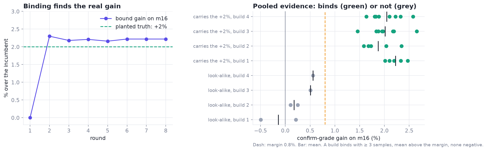

# 5 · What to try next: the measured game

*With more legal designs than GPU time, which ones do you measure?*

> **Previously.** Measurement decides what is faster. This chapter decides what gets measured.

| At a glance | |
|---|---|
| **Problem** | The legal space holds thousands of designs and a day buys a few hundred measurements. |
| **Idea** | A learned ranker (a LightGBM bootstrap ensemble with an upper confidence bound) picks candidates; compile first; bind only pooled, replicated evidence. |
| **What it bought** | Bound wins, a per-size build that kept one load's gain without costing the others, and the decoder × arithmetic interaction [M]. |
| **Code** | `xcalibur.surrogate`, `xcalibur.game` |
| **Notebook** | [05 · The measured game](../notebooks/05_the_measured_game.ipynb) |

---

## 1. The game

Design is played as a game over trees of designs. A model ranks; it never decides:

- **Nodes** are complete designs; **moves** change one part (a compile-time knob, a field of a design grammar, a
  code move); **new nodes** are designs nobody has measured.
- **Values are measured**, per load: the log speedup over a fixed reference, from the judge-faithful bench.
- **Trees** are kept per (starting design, build), because a build only serves some problem sizes.

## 2. One round (`xcalibur.Game`)

1. **Fit.** Per load, a bootstrap ensemble of LightGBM regressors (`xcalibur.Surrogate`) on every measured design.
2. **Rank.** Score the frontier by an upper confidence bound, mean + κ·spread, keeping only designs that reach that
   load's build (`ReachMap.reaches`).
3. **Compile first.** Compile about twice as many candidates as you will time, on CPU. Errors and identical code are
   decided here, exactly.
4. **Re-rank with compiled features.** Real SASS counts replace guesses; time the top half.
5. **Screen**, then **confirm** screen leaders (and earlier single-sample leaders) next to the incumbent.
6. **Bind** by pooled evidence: ≥ 2 samples of the same build identity, mean above the margin, no negative sample.

Everything problem-specific is a callback (`frontier`, `featurize`, `compile`, `measure`), so the same loop runs over
compile-time knobs, a design grammar, or any other finite space.

**The two rules in math.** Rank the frontier per load $l$ with a bootstrap ensemble of $K$ LightGBM models $f_k$ [[LightGBM](#lightgbm)] and an upper confidence bound:

$$
\text{UCB}_l(d) = \mu_l(d) + \kappa\,\sigma_l(d), \qquad \mu_l = \tfrac{1}{K}\textstyle\sum_k f_k(d), \quad \sigma_l = \operatorname{sd}_k f_k(d).
$$

Bind a build identity for load $l$ only when its confirm-grade gains $g_1, \dots, g_n$ satisfy
$n \ge n_{\min}$, $\bar g > m$ and $\min_i g_i > 0$.

On a toy problem with one planted +2% gain, the loop binds it in round 2 and the look-alikes never pass the rule:

Worked through in [notebook 05](../notebooks/05_the_measured_game.ipynb).

## 3. Pieces that made it work

- **Aim at real losses.** A move enters a tree only if the part of the kernel it changes takes at least 0.5% of that
  load's measured time. That keeps the search on time that actually exists. (The time table is itself an estimate,
  so allow the occasional test past it.)
- **Features with physical meaning:**
  - which value each field takes;
  - the 32 bits of a decoder's code, which let the model generalize to decoders nobody has measured;
  - instruction counts from the compiled code;
  - the WarpSpeed plan's derived numbers (register cap, warps per scheduler, bytes in flight).
- **Parking.** A move with proof that it can't work (a compile error, a hang, code identical to its parent) is never
  proposed again. A move that only *lost on its own* stays allowed inside combinations, because interactions are where
  the gains were.
- **A real stop rule, or none.** "Two rounds without beating the incumbent by more than noise" is a good stop for a
  knob search. With a learning proposer in the loop, keep going.

## 4. What it found, and what that taught

- **It finds bound wins.** On a large-batch build it bound a three-knob node at +2.06% summed over its loads [M].
- **Winners don't transfer automatically.** Moved onto a better base design, the same knobs still gained +1.0% to
  +1.5% on one load but cost another 0.5–0.7%; another bound winner reversed to −0.4% [M]. A gain belongs to the
  design it was measured on.
- **Per-size builds keep a gain without paying for it elsewhere.** Giving the winning load its own build left the
  other loads on identical code; on the judge, that load dropped from 123.0 µs to 121.4 µs [M].
- **Single replicates mislead.** Two designs with *identical* code for a load read +0.44% and +1.75% in the same
  session [M]. Pooling by build identity, and requiring two samples, is what separates a 0.9% effect from noise.

## 5. With a language model as a proposer

The game can take proposals from a planner (see [chapter 9](09-anvil.md)), checked by the same exact rules and repaired by a
refiner. With only a snapshot of each tree, the planner's nodes all lost [M]. What it needs is context: the full
history of the tree, its own past proposals with their outcomes, the code each knob controls, and measured facts about
what transferred.

## References

- **[LightGBM]** Microsoft. *LightGBM.* The ranker in the measured game. [link](https://github.com/microsoft/LightGBM)

Full list: [references.md](references.md).

---

[← 4 · Measurement](04-measurement.md) · [Contents](README.md) · [6 · Knowledge graphs →](06-knowledge-graphs.md)
