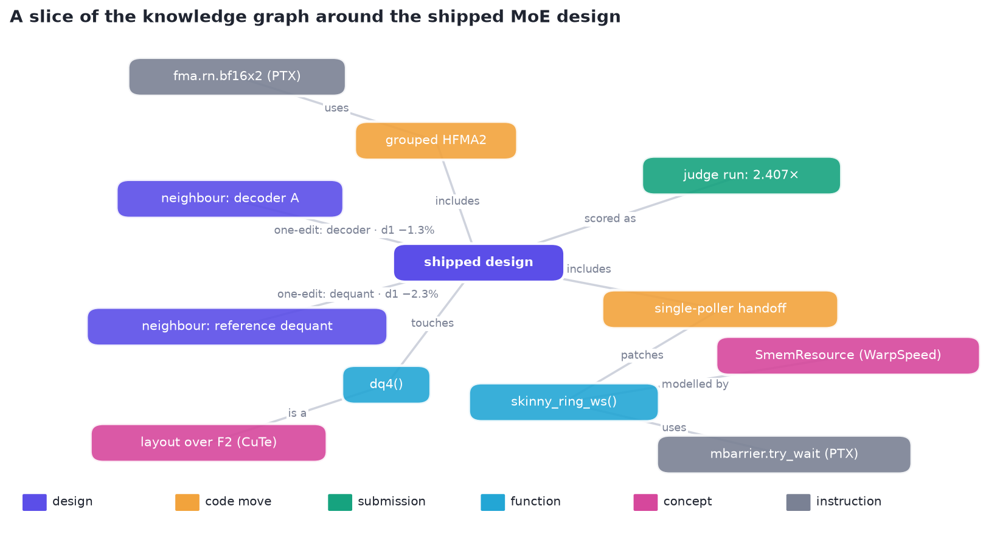
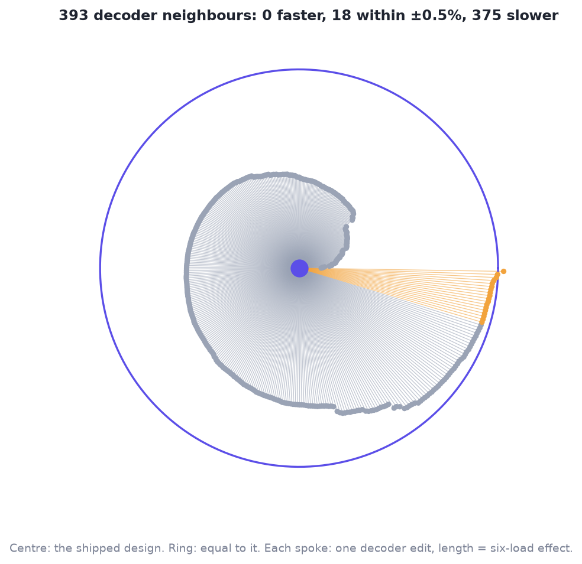
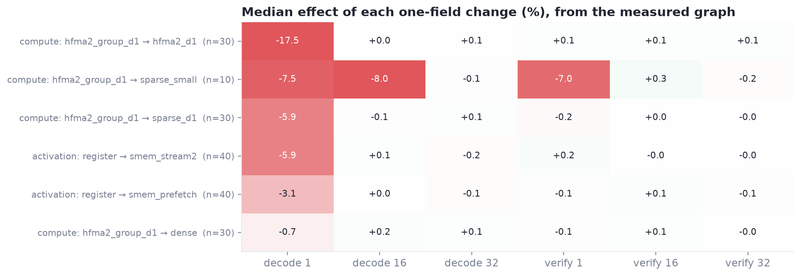
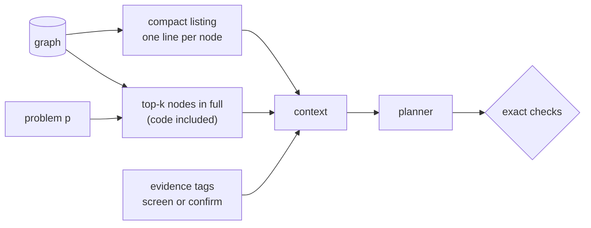

# 6 · What we know: knowledge graphs

*How do hundreds of measurements, a kernel's source, papers, an ISA and other teams' notes become something a planner can read?*

> **Previously.** The game produces hundreds of measurements a day. This chapter is how they are kept, queried and handed to planners, together with what the field already knows.

| At a glance | |
|---|---|
| **Problem** | What we know is scattered across runs, code, papers and other teams' notes; a planner can't build on what it can't see. |
| **Idea** | Typed graphs with evidence on every measured node, and three queries: neighbourhood, aggregate effect, retrieval. |
| **What it bought** | "Did we try this?" as a lookup; an effect table that rediscovered the reach map from data; the whole design graph in one model context [M]. |
| **Code** | `xcalibur.graph` (`DesignGraph`, `Retriever`, `embedding_gemma`) |
| **Notebook** | [07 · Knowledge graphs](../notebooks/07_knowledge_graphs.ipynb) |

---

## 1. Why graphs

What we know arrives in different shapes: measurements of designs, kernel source, papers and instruction manuals,
other teams' notes. A planner, person or model, asks the same three kinds of question of all of it: *what is next to
this, what did changing X do, and what is relevant to this problem?* A **knowledge graph** answers all three when
every piece is a typed node, every relation a typed edge, and every measured node says how it was measured.

## 2. The objects

$$
G = (V, E), \qquad \tau_V : V \to \{\text{design}, \text{code move}, \text{submission}, \text{function}, \text{concept}, \text{instruction}\},
\qquad \tau_E : E \to \{\text{one-edit}, \text{touches}, \text{scored as}, \text{uses}, \text{is a}\}.
$$

A measured node $v$ carries its value $J_\ell(v)$ on every load $\ell$ (a paired speedup, chapter 4) and an
**evidence grade**: a 4-seed screen or a 12 × 2 confirm.

| Node kind | Example | Carries |
|---|---|---|
| design | the shipped MoE design | its fields, per-load results, evidence grade |
| code move | grouped HFMA2, single-poller handoff | the patch text, its preconditions, its results |
| submission | a judged file | the judge's per-load times |
| function | `dq4()`, `skinny_ring_ws()` | the kernel source a move can patch |
| concept | a CuTe layout over F₂, WarpSpeed's `SmemResource` | definitions and theorems from the papers and libraries |
| instruction | `fma.rn.bf16x2`, `mbarrier.try_wait` | PTX syntax, examples and semantics |

| Edge kind | Meaning |
|---|---|
| one-edit | two designs that differ in exactly one field, labelled with the measured ratio per load |
| touches / patches | a design or move changes this function |
| scored as | a design and the judged file that carries it |
| uses / is a / modelled by | links from code to the concepts and instructions it relies on |

Code graphs are built the same way: parse source and documentation once into nodes and typed edges, then query
structure instead of grepping text.

## 3. Three queries

### 3.1 Neighbourhood: what is one edit away?

$N(v) = \{ w : (v, w) \in E_{\text{one-edit}} \}$, each with its measured ratio. Around the shipped design, all 393
designs one decoder edit away: none reads more than 0.5% above it, 18 sit within noise, 375 are slower [M]. Read
from the graph, that says the shipped decoder is a local optimum of this space before a single confirm is spent.

### 3.2 Aggregate effect: what does a field change do?

For a field change $f: a \to b$, over every one-edit pair $(u, w)$ that makes it:

$$
\delta_\ell(f{:}\,a \to b) = \operatorname{median}_{(u,w)} \frac{J_\ell(w)}{J_\ell(u)} .
$$

Nobody told the graph which compiled build each field reaches. Its effect table shows it anyway: the dequant
arithmetic and the activation staging move **decode 1** and leave the other loads within noise, except
`sparse_small`, which also moves decode 16 and verify 1, the small builds it is compiled into [M]. **The graph
rediscovered the reach map from data**; chapter 2 derives the same map from the code [D]. Before we had the exact map,
this table was how planners learned which field moves which load.

### 3.3 Retrieval: what is relevant to this problem?

$$
\operatorname{retrieve}_k(q) = \operatorname{top}_k \; \langle e(q),\, e(v) \rangle, \qquad \lVert e(\cdot) \rVert = 1,
$$

with $e$ an embedding model: EmbeddingGemma, with documents as `title: … | text: …` and a code-retrieval prompt for
queries [[EmbeddingGemma 2025](#embeddinggemma-2025)]. Retrieval puts the closest nodes into a model's context in full; the graph adds the
neighbourhoods and aggregates that retrieval alone can't give.

**Similarity is not quality.** In notebook 07, the 8 nodes most similar to "faster one-token decode from a grouped
HFMA2 dequant" are mostly *slower* designs (down to −8.7% on that load), because they share words, not results. So a
planner's context is assembled from four parts, in this order:

1. **The whole graph as a compact listing**, one line per node with per-load results as signed percents, first in the
   prompt so a model server's prefix cache reuses it. About 735 nodes fit in about 25k tokens.
2. **The retrieved nodes in full**, code included.
3. **The evidence grade of every row**, and the measured noise floor. Without them, a planner chases lucky screens.
4. **Exact checks after the plan**, because no amount of context makes a plan legal.

## 4. The graphs we kept

| Graph | What's in it | Size |
|---|---|---|
| **Design graph** | every measured design, code move, game leaf and judged submission; the patchable kernel functions | about 735 nodes |
| **CuTe graph** | the CuTe layout papers' definitions and theorems, and the code they map to [[Cecka 2026](#cecka-2026)] | 1,106 nodes |
| **PTX graph** | the PTX ISA: instructions, syntax, examples, semantics [PTX] | 743 nodes |
| **WarpSpeed graph** | CCCL's WarpSpeed structs and functions with their documentation [CCCL] | 154 nodes |
| **Co-design graph** | rules and facts recorded by earlier co-design games | 617 nodes |
| **SASS graph** | per-kernel statistics of our own kernels: registers, spills, inner-loop opcode mix | 279 nodes |
| **Knowledge base** | our briefs, reviews, ledgers and kernels, plus 17,700 chunks from 5,399 public H100 submissions [KernelBot]; BM25, a link graph, and embeddings | 41,685 vectors |
| **Scoper graph** | repos, PRs and papers reached by following links, mechanism searches and citers of key papers | 2,442 nodes, 5,809 edges |

## 5. What the field knows: intel

Most of our expensive mistakes were not engineering mistakes. They were missing information: a project that had
already solved our sub-problem, a tool already in the judge's image, a premise ("library X is the limit") that someone
had already measured to be false. The scoper graph and the knowledge base exist to find those before building.

**The source map.** Intel is a grid of actors and channels; sweep the cells a concrete question touches.

| Actor | What they know | Channels |
|---|---|---|
| **Customer** (engine maintainers, model owner) | what the reference does, what's coming | PRs, issues and roadmaps since the judge's pinned version; the model card; the owner's kernels |
| **Competing engines** | how others implement the same operator | PRs, release notes and technical blogs for the exact operators [[Kwon 2023](#kwon-2023); [Zheng 2024](#zheng-2024)] |
| **Suppliers** (CUTLASS/CuTe, cuBLAS, FlashInfer, DeepGEMM, CCCL) | the "buy" options and their limits | repos, release notes, and which versions are in the judge's image |
| **Academia and community** | new mechanisms | recent arXiv, lab blogs, competition write-ups, public kernels [[KernelBot](#kernelbot)] |
| **Other competitors** | what works on this exact problem | board trajectory, public repos, their measured-facts documents |
| **Hardware** | instruction rates, latencies, limits | microbenchmark papers, our own probes |

**When to sweep.** Not before every decision, which floods the context. Sweep when a **new track** starts, when a
**premise is about to drive a decision** ("X is the limit", "nobody does Y"), or after **two null runs on a lever**.

**What intel taught us.**
- **Never dismiss a source by its label.** A project filed under robotics held exactly the one-token GEMV design rule
  we needed.
- **Query by mechanism, across format names.** INT4, MXFP4, NVFP4 and NF4 kernels share their tricks; a query for one
  format name missed a key project that used another.
- **Read other teams' measured facts before building.** One team's public H200 notes said 12-bit in-register weight
  decode loses at 128+ tokens. We read it before building a projection kernel, and our measurement agreed: a
  well-built TMA streaming ring came within 3% of cuBLAS at best and did not beat it without fewer bytes [M].
- **Read primary sources in full.** The rules, not a summary; a summary got the prize structure wrong.
- **Check the image.** Every toolchain the rules allowed was in the judge's image. Assuming otherwise closed options
  for no reason.

## 6. What graphs bought us, and what they didn't

**Bought.**
- **"Did we already try this?" became a lookup.** The knowledge base twice found an earlier measurement we were about to
  repeat [M].
- **Effects before exact maps.** The one-field effect table told planners which field moves which load before the
  reach map was derived.
- **Exact syntax for code moves.** PTX and WarpSpeed retrieval gave the refiner the instructions and rules a patch needs.
- **"Build on what's measured" for a model.** The whole design graph fits in one context once it is compact.

**Didn't.**
- **Similarity is not quality** (section 3.3). Retrieval needs evidence grades and exact checks beside it.
- **Graphs don't locate time.** No graph tells you where *your* kernel's microseconds go. A measurement does.

## 7. In the code

| | |
|---|---|
| `xcalibur.Node`, `xcalibur.DesignGraph` | nodes with fields, per-load results and evidence; `one_edit()`, `effects()`, `listing()` |
| `xcalibur.Retriever` | top-$k$ by embedding similarity, any embedding function |
| `xcalibur.embedding_gemma()` | an EmbeddingGemma embedding function (documents vs code-retrieval queries) |

## References

- **[EmbeddingGemma 2025]** Google. *EmbeddingGemma: Powerful and Lightweight Text Representations.* arXiv:2509.20354, 2025. The embeddings for retrieval. [link](https://arxiv.org/abs/2509.20354)
- **[Cecka 2026]** C. Cecka. *CuTe Layout Representation and Algebra.* arXiv:2603.02298, 2026. The CuTe graph and the decoder-as-layout view. [link](https://arxiv.org/abs/2603.02298)
- **[PTX]** NVIDIA. *Parallel Thread Execution ISA.* The PTX graph for retrieval. [link](https://docs.nvidia.com/cuda/parallel-thread-execution/)
- **[CCCL]** NVIDIA. *CUDA Core Compute Libraries (CCCL)*, WarpSpeed in `cub/detail/warpspeed`. The plan language and our checker's semantics. [link](https://github.com/NVIDIA/cccl)
- **[KernelBot]** GPU MODE. *KernelBot data.* The public submissions in our knowledge base. [link](https://huggingface.co/datasets/GPUMODE/kernelbot-data)
- **[Kwon 2023]** W. Kwon et al. *Efficient Memory Management for Large Language Model Serving with PagedAttention* (vLLM). SOSP 2023. The TG4DAC baseline. [link](https://arxiv.org/abs/2309.06180)
- **[Zheng 2024]** L. Zheng et al. *SGLang: Efficient Execution of Structured Language Model Programs.* NeurIPS 2024. The challenge's baseline. [link](https://arxiv.org/abs/2312.07104)

Full list: [references.md](references.md).

---

[← 5 · The measured game](05-measured-game.md) · [Contents](README.md) · [7 · The OODA loop →](07-OODA.md)
