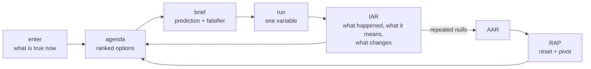

# 7 · How we decide: the OODA loop

*When every run is scarce and the noise is as large as the gains, how do you make, record and check decisions?*

> **Previously.** The knowledge graphs are memory. The OODA loop is how memory turns into the next decision.

| At a glance | |
|---|---|
| **Problem** | Decisions made on predictions, lessons that didn't stick, and runs batched and read together. |
| **Idea** | One run, one written review, then the next decision; every lesson becomes an enforced check; gates before anything public. |
| **What it bought** | Every gain that held was chosen by measure-and-select, and most mistakes were caught at the review [M]. |
| **Code** | `xcalibur.gates` (`lint`, `rules_gate`, `Card`) |
| **Notebook** | — |

---

A search system can run unattended; deciding what it should search, what counts as evidence, and what is allowed
to go public cannot. We run those decisions through an Observe–Orient–Decide–Act loop with written artifacts,
enforced gates and short reviews. This document describes the loop, its artifacts, and what we learned running it.

---

## 1. Why a loop, and why written

Three failure patterns kept recurring before the loop existed:

- **Decisions made on predictions.** A plausible mechanism, priced by a model, chosen over a measured one.
- **Lessons that didn't stick.** A lesson written in a document was repeated a few days later.
- **Batching.** Several runs launched back to back, read together, with steps skipped in between.

The loop answers each one: every decision names the *measured* loss it targets; lessons become *enforced checks*
(a gate field or a tool rule), not prose; and the cadence is **one run, one review, then the next decision**.

## 2. The cycle

| Step | Question | Artifact |
|---|---|---|
| **Enter** | What is true right now? | an entry note: rules version, the newest material, the boards and our rows, today's budget, the blocked levers, the last results |
| **Agenda** | What could we do, ranked? | every live branch with its expected value per run and its evidence |
| **Brief** | What exactly will this run test, and why this one? | a brief (below); a tool refuses to run without it |
| **Run** | — | the result, recorded from the judge's own numbers |
| **IAR** | What happened, what does it mean, what changes? | an interim action review (below) |
| **AAR / RAP** | Why do we keep missing, and what's the new plan? | an after-action review and a reset-and-pivot plan, on a tripwire |

Each step refuses to run without the previous step's artifact. The point is not ceremony: it is that a fresh
person (or agent) can pick up the work from the files alone.

## 3. The artifacts

**Brief (before any build).**
- *Observe*: what changed since the last review.
- *Re-rank*: at least three alternatives, with expected value per run.
- *Prior art*: earlier rows with the same mechanism, and why their result does not apply now.
- *Constraints*: the rules version and the rules, user directives and inferences this relies on.
- *Design*: one variable per arm.
- *Predictions*: an estimate **only from a measured analog** (else "unknown"), a falsifier, and a pre-mortem of at
  least two ways the time could go elsewhere.

**IAR (after each run).** Three sections, short:
1. *What happened*: a graded table against the brief.
2. *What it means*: the mechanism, and any phase the brief missed.
3. *Do something about it*: a general lesson and the next action.
Plus one line: the moment I'd like back.

**AAR (on a tripwire or a direction change).** What happened (decisions with verdicts), the highlight reel, the
moment I'd like back, the *habits* behind the failures (not one-off causes), and lessons written **as checks**.

**RAP (reset and pivot).** The reset (score, field, assets, retired assumptions, the gap sized) and the pivot
(ranked options with value and cost, the decision, today's milestone and a stop-loss).

**Ledger.** One row per run, filled from the judge's JSON, never typed by hand: what was predicted, what was
measured, the outcome band, the phase that was missed.

**Constraints.** Every constraint lives in one file with its source: **RULE** (quoted, versioned), **USER** (a
directive, dated) or **INFERENCE** (ours). An inference may not close a branch until it is verified against a rule
or a directive. "Library X is banned" was once an inference; it cost runs before anyone checked the rules.

## 4. Gates on anything public

- **Submit through one door.** A single command submits, and it refuses unless two checks pass:
  - the live rules version matches the version we read in full;
  - the file passes a lint (`xcalibur.gates.lint`) for things that don't belong in a timed call: host
    synchronization, device-to-host reads, side streams, graph capture, timing code, measurement scaffolding.
- **A card before every scarce run** (`xcalibur.gates.Card`): the parent and its score, the measured loss targeted,
  an estimate from a measured analog, the budget used, the risk, the noise band, what the result would teach, and one
  falsifier. A person approves each run.
- **Checks are submissions.** A check run carries one real candidate prepared like a submission. It is not a probe and
  not a way to time several variants at the judge's expense.
- **No re-rolls.** Identical logic is never resubmitted to fish for a luckier score; final standings come from reruns
  anyway.
- **Withdraw what turns out wrong.** Anything later found to be fast only because of how it was measured comes off
  the board.

## 5. Standing orders

1. **Re-rank before designing.** No inherited priority for a failed arm's fix, an intel item or a suggestion.
2. **Cost every phase the hardware runs:** each operand's traffic at every memory level, reductions, syncs, atomics,
   epilogues, tails, latency chains.
3. **Measure many, select by measurement.** Models generate and prune; matched pairs pick.
4. **Close a branch only on evidence,** and say what was and wasn't tested.
5. **Adopt a winner only when it replicates** beyond that load's noise.
6. **Apply measured-best facts at the next composite.** A known-better kernel once sat unused for nine runs.
7. **Read primary sources in full.** The rules, the problem text, the terms.

## 6. Why it worked

"Worked" means two things we can point to: every gain that held on the judge was chosen inside this loop by
measure-and-select, and most of the mistakes we caught, we caught at the review step [M]. This is our account of a
single campaign, not a controlled experiment. Five mechanisms explain it.

**1. Orientation is where decisions go wrong, so we wrote it down.** A loop is won or lost in *orientation*, the picture of the
situation you decide from. Ours is a set of files: the entry
note, the ledger, the constraints file and the knowledge graphs (chapter 6). When orientation lived in memory, a
known-better kernel sat unused for nine runs; once "apply measured-best facts at the next composite" was a checklist
item, that could not recur [M].

**2. Writing the prediction first makes errors visible.** A brief states an estimate (from a measured analog, else
"unknown"), a falsifier and a pre-mortem before the run. Each run then tests our understanding, not just
the kernel, and written predictions can be scored against what happened. That is how we learned our time models were optimistic
on 30 of 30 predictions one day, and that one predicted −4.6 µs on a load that measured +15.5 µs [M]: the evidence
behind "estimators don't select".

**3. One run, one review keeps attribution clean.** With one variable per arm and a review before the next brief,
each result has one cause to explain. The reviews caught a no-op measured as a gain, a transferred winner that
reversed on another load, and a bench that disagreed with the judge [M]. In a batch, each would have compounded.

**4. Lessons became invariants.** A review asks what was supposed to happen, what happened, why, and what to sustain or
change. We added one step: a lesson becomes a gate field, a tool refusal or a lint
rule. Lessons kept as prose recurred; enforced ones did not [M]. The reach check is an example: after 8 of 9
measurements in one round timed changes that could not touch their target build, "check reach first" went from a
written lesson to a refusal in the tool (chapter 2).

**5. Every constraint carries its source.** RULE, USER or INFERENCE. "Library X is banned" was an inference that cost
runs before anyone checked the rules [M]. After that, an inference could not close a branch until a rule or a
directive confirmed it.

**And it stayed useful because we cut what didn't change decisions.** At one point every brief carried a mandatory
chain of documents and model-priced estimates, and the loop produced documents instead of decisions. We kept the
artifacts that change the next move (brief, review, ledger, card) and dropped the rest. Narrow scope helped too: one
thread at a time, with short updates (the numbers and the next step), beat several half-watched experiments.

---

[← 6 · Knowledge graphs](06-knowledge-graphs.md) · [Contents](README.md) · [8 · Shipping →](08-shipping.md)
