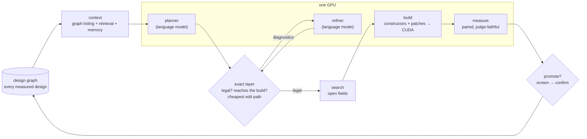

# 9 · Putting it together: Anvil, an agent with on-device search

*What does the whole loop look like with the models inside it, on one GPU?*

> **Previously.** Every chapter so far is one part. TG4DAC showed models can plan; the challenge showed the exact layer and measured search find the gains. Anvil puts the models inside that loop.

| At a glance | |
|---|---|
| **Problem** | The parts worked separately: models plan (chapter 1), the exact layer and measured search find gains (chapters 2–5). |
| **Idea** | One agent: planner and refiner inside the exact layer and the measured search, with the graphs as memory, all on the GPU being optimized. |
| **What it bought** | This chapter is the formulation; it reports no results. |
| **Code** | `xcalibur.planner`, `xcalibur.graph`, `xcalibur.reach`, `xcalibur.bench`, `xcalibur.stats` |
| **Notebook** | — |

---

## 1. The idea in one paragraph

A language model proposes changes to a GPU kernel. An exact layer says which proposals can exist. A refiner repairs
the ones that can't. A search fills in what the plan left open. The same GPU then compiles each candidate and times it
the way a judge would. Every result joins a design graph that the next plan reads. Nothing in the loop leaves the
machine: the models, the checks, the compiler and the stopwatch all share **one device**, the one the kernel runs on.

**Why "Anvil".** A blade is shaped on the anvil, not on paper. Anvil shapes kernels on the same GPU that runs them,
and the metal has the last word: nothing is kept that the hardware didn't measure.

## 2. The objects

**Problems.** A kernel is called at several sizes. Each size $p \in \mathcal{P}$ is a separate problem, because the
kernel picks a separately compiled **build** $b(p)$ by token count. For the MoE kernel,
$\mathcal{P} = \{\text{d1}, \text{d16}, \text{d32}, \text{v1}, \text{v16}, \text{v32}\}$.

**Designs.** A design is a point in a product of fields plus a set of code moves:

$$
x \in \mathcal{X} = \prod_{f \in F} \mathcal{X}_f \times 2^{\mathcal{L}},
$$

where the fields $F$ are typed choices (decoder graph, dequant arithmetic, activation staging, ownership, pipeline
depths, dispatch cutoff, work map) and $\mathcal{L}$ is a library of code moves (patches) with exact preconditions.

**Reach.** Each build compiles only some fields: $\text{fields}(b) \subseteq F$. A change *reaches* problem $p$ only
if it touches one of them:

$$
\text{reach}(p, x, c) \;=\; \big[\, \exists f \in \text{fields}(b(p)) : x_f \neq c_f \,\big].
$$

**The exact layer.** A predicate with typed diagnostics, decided before anything compiles:

$$
\text{legal}(x) = \bigwedge_{k} \text{check}_k(x), \qquad \Delta(x) = \{\text{the failing checks, with counterexamples}\}.
$$

The checks are exact, not estimated: the decoder must be an invertible map over GF(2) with a packing
$T = D^{-1}P$ ([chapter 2](02-exact-layer.md)); the warp-specialized plan must fit registers, shared memory and
barriers ([chapter 3](03-warpspeed.md)); every code move must apply cleanly; every field value must satisfy its
contract.

**Edit paths.** Between the incumbent $c$ and a plan $x$, the cheapest legal order of edits:

$$
\text{path}(c \to x) = \arg\min_{c = x_0 \to x_1 \to \dots \to x_n = x} \;\sum_i \text{rebuild}(x_{i-1}, x_i),
\qquad \text{legal}(x_i)\ \forall i,
$$

found by Dijkstra's algorithm over one-edit moves. Every intermediate is a valid kernel, so the path doubles as a list of
matched pairs that isolate each edit.

**The design graph.** $G = (V, E)$: every design ever measured, with its per-problem value and an evidence grade
(screen or confirm), edges for one-edit relations, and the measured effect of each single-field change. Nodes carry
their code and are embedded for retrieval, alongside graphs of the kernel's source.

**The value.** Measured, never predicted. For problem $p$, the median of paired ratios against a frozen reference
$r$, timed alternately (ABBA) from a cold L2 with CUDA graphs:

$$
J_p(x) = \operatorname{median}_i \frac{t^{(i)}_p(r)}{t^{(i)}_p(x)} .
$$

## 3. One round

For every problem $p$, with incumbent $c_p$ and memory $M_p$ (the agent's own last plans for $p$, their diagnostics,
repairs and measured outcomes):

1. **Context.** $C_p = \big(\text{listing}(G),\ \text{retrieve}_k(G \cup \text{code graphs};\ p),\ M_p,\ c_p\big)$.
   The whole graph goes in, compactly, with retrieved nodes in full.
2. **Plan.** $x \sim \pi_{\text{plan}}(\cdot \mid C_p;\ \tau)$, one plan per problem, at temperature $\tau$ read from a
   control file each round.
3. **Check.** Compute $\Delta(x)$, $\text{reach}(p, x, c_p)$ and $\text{path}(c_p \to x)$.
4. **Refine.** $x' = \pi_{\text{ref}}(x, \Delta(x))$, then check again. The refiner works from exact counterexamples
   ("319,632 B of shared memory exceed 232,448 B per CTA"), not from scores.
5. **Search.** Take $x'$ and a searched variant over the fields the plan left open.
6. **Build.** Constructors and patches lower each design to CUDA; the compiler and the exact gates run on the box.
7. **Measure.** $J_\ell(x')$ on every problem $\ell$, not only $p$, so side effects are seen.
8. **Promote.** A contender must clear a margin at screen grade, then hold at confirm grade next to the incumbent:

$$
J_p(x') > (1 + m)\, J_p(c_p) \ \text{(screen)} \quad\Longrightarrow\quad \text{re-time at } 12 \times 2;\ \ c_p \leftarrow x' \text{ if it holds.}
$$

9. **Remember.** Add every measured design to $G$ and embed it; append the round to $M_p$; code that helps its target
   joins the library $\mathcal{L}$.

The output is one incumbent per problem. Because each problem has its own build, the incumbents combine into a single
kernel as **per-size builds**, each load running its own winner ([chapter 8](08-shipping.md)).

## 4. Why on the device

- **No gap between idea and verdict.** The planner's proposal is compiled and timed on the hardware that will run it,
  minutes later, by the same rules the judge uses. Nothing is ranked by a cost model.
- **The agent's knowledge is the device's history.** The context is the graph of what this GPU measured, so every
  claim a plan builds on has a measured source.
- **One box.** A single GPU serves the models (the planner and refiner take a share of its memory), runs the compiler,
  and times the kernels. The loop needs no cluster, which fits xCalibur's aim of solving tractable problems on
  hardware people own.

## 5. The roles, and where they come from

| Role | In Anvil | Lineage |
|---|---|---|
| Planner | Gemma 4 31B with a planning adapter, temperature from a control file | TG4DAC's planner, trained to run CuTe layout algebra while planning ([chapter 1](01-tg4dac.md)) |
| Refiner | Gemma 4 31B with a WarpSpeed adapter | TG4DAC's refiner, trained on worked WarpSpeed plans with real checker runs |
| Exact layer | GF(2) decoders, WarpSpeed accounting, contracts, patch gate, reach, Dijkstra | [chapter 2](02-exact-layer.md) |
| Retrieval | EmbeddingGemma over design nodes and code graphs | [chapter 6](06-knowledge-graphs.md) |
| Measurement | judge-faithful paired bench, screen then confirm | [chapter 4](04-measurement.md) |

## 6. In the code

| Term | Module |
|---|---|
| $\text{legal}$, $\Delta$ (decoders) | `xcalibur.gf2` |
| $\text{legal}$, $\Delta$ (warp specialization) | `xcalibur.warpspeed` (also a tool schema a model can call) |
| $\text{reach}$, build identity | `xcalibur.reach` |
| $G$, retrieval | `xcalibur.graph` |
| $\pi_{\text{plan}}$, $\pi_{\text{ref}}$, memory, temperature file | `xcalibur.planner.PlannerLoop` |
| $J$, paired timing | `xcalibur.bench` |
| promotion and binding rules | `xcalibur.stats.Evidence` |

## 7. Design notes

- **Fit the context.** Encode the graph one line per node and put it first in every prompt, so the model server's
  prefix cache reuses it across problems.
- **Tag evidence.** Mark each row as a screen or a confirm, and state the noise floor; otherwise a planner chases
  lucky screens.
- **Check reach before measuring.** A plan for one size that only touches another size's build is a no-op, and
  measuring it wastes a round.
- **One plan per problem.** Plans for different sizes don't compete for the same slot, and wins never cancel.

## References

- **[EmbeddingGemma 2025]** Google. *EmbeddingGemma: Powerful and Lightweight Text Representations.* arXiv:2509.20354, 2025. The embeddings for retrieval. [link](https://arxiv.org/abs/2509.20354)

Full list: [references.md](references.md).

---

[← 8 · Shipping](08-shipping.md) · [Contents](README.md) · [References →](references.md)
