# xCalibur documentation

The documentation is one story in nine chapters. Each chapter answers one question, opens with a short "at a glance"
box, links the notebook that works through its math, and ends with its references. Read them in order, or jump to the
question you care about.

| | Chapter | The question it answers |
|---|---|---|
| 1 | [The question: TG4DAC](01-tg4dac.md) | Can small language models co-design GPU kernels if they speak layouts and warp specialization? |
| 2 | [What can exist: the exact layer](02-exact-layer.md) | Which kernels are legal, and which changes can matter, before anything compiles? |
| 3 | [Warp specialization you can check: WarpSpeed](03-warpspeed.md) | How do you describe a warp-specialized kernel so a model can write it and a checker can prove it fits? |
| 4 | [What is faster: measurement](04-measurement.md) | How do you tell a 1% gain from noise, when the noise is 1%? |
| 5 | [What to try next: the measured game](05-measured-game.md) | With more legal designs than GPU time, which ones do you measure? |
| 6 | [What we know: knowledge graphs](06-knowledge-graphs.md) | How do measurements, code, papers and other teams' notes become something a planner can read? |
| 7 | [How we decide: the OODA loop](07-OODA.md) | How do you make, record and check decisions when every run is scarce, and why did it work? |
| 8 | [From pieces to one file: shipping](08-shipping.md) | How do measured pieces become one honest submission? |
| 9 | [Putting it together: Anvil](09-anvil.md) | What does the whole loop look like with the models inside it, on one GPU? |

```mermaid
flowchart LR
  C1["1 · TG4DAC<br/>models can plan"] --> C2["2 · exact layer<br/>what can exist"]
  C2 --> C3["3 · WarpSpeed<br/>checkable plans"]
  C3 --> C4["4 · measurement<br/>what is faster"]
  C4 --> C5["5 · measured game<br/>what to try"]
  C5 --> C6["6 · knowledge graphs<br/>what we know"]
  C6 --> C7["7 · OODA<br/>how we decide"]
  C7 --> C8["8 · shipping<br/>one honest file"]
  C8 --> C9["9 · Anvil<br/>all of it, on one GPU"]
```

**Also here.**
- [The full report](overview.md): every chapter's content in one long document, for reading start to finish.
- [References](references.md): every source the chapters cite, grouped by topic.
- [Notebooks](../notebooks): seven notebooks that rebuild every figure from [`../data`](../data) and work through the math.

**Evidence tags.** **[M]** measured on hardware · **[D]** derived exactly, by a checker or from source code. Anything
without a tag is our description or reasoning, not a result.

## Glossary

| Term | Plain meaning |
|---|---|
| **Kernel** | a program that runs on the GPU |
| **Load** | one problem size the judge times (for example "decode with 16 tokens") |
| **Build** | one compiled version of a kernel; the kernel picks a build by problem size |
| **Warp / warpgroup** | 32 GPU threads that run together / 4 warps that issue matrix instructions together |
| **CTA** | a block of warps that share fast on-chip memory |
| **Shared memory** | the fast on-chip memory a CTA's warps share |
| **L2** | the GPU's larger cache; a "cold L2" means nothing useful is cached before a timed run |
| **TMA** | the GPU's copy engine, which moves tiles of data into shared memory by itself |
| **mbarrier** | a counter in shared memory that warps use to wait for each other or for a copy to land |
| **SASS** | the GPU's machine code; comparing it shows exactly whether two builds are the same |
| **CuTe layout** | a function from coordinates to memory positions (from NVIDIA CUTLASS); here also used over bits |
| **GF(2)** | arithmetic on single bits (XOR is addition); bit-shuffling decoders are linear maps over it |
| **Decoder** | the bit operations that turn packed 4-bit weights into 16-bit numbers before the math |
| **WarpSpeed** | NVIDIA CCCL's way of describing a warp-specialized kernel: squads, staged buffers, phases |
| **Squad / stage / phase** | a group of warps with one job / one slot of a shared-memory ring / one step in that slot's cycle |
| **Reach** | whether a change can affect the build that serves a given load |
| **Screen / confirm** | a quick measurement that nominates / a longer one, next to the current best, that decides |
| **ABBA pairs** | alternating the two kernels being compared (A B B A ...) so slow drift cancels out |
| **A/A** | timing the reference against itself, to see how large the noise is |
| **Binding** | the rule for when a measured gain counts (repeated, above a margin, never negative) |
| **UCB** | "upper confidence bound": rank by expected gain plus uncertainty, so the search also tries what it is unsure about |
| **Per-size build** | a build that serves only one load's size range, so its gain doesn't change the other loads |
| **OODA** | observe, orient, decide, act: the cycle every run goes through, with a written review at the end |
| **Knowledge graph** | typed nodes (designs, code, concepts, instructions) joined by typed edges, with how each result was measured |
| **On-device search** | Anvil's setup: the models, the exact checks, the compiler and the timer all on the GPU being optimized |
| **IAR / AAR / RAP** | the short review after each run / the deeper review after repeated misses / the reset-and-pivot plan |
