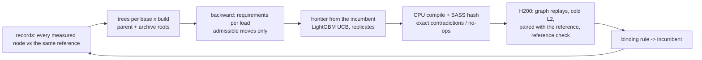
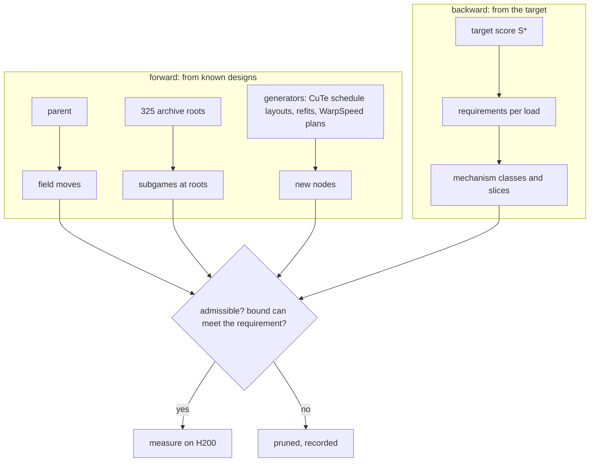

# Co-designing GPU kernels as a measured search game

*okc `muse_moe_w4a16` (NVFP4 MoE, W4A16) on H200. Working document, 2026-11-04.*

Evidence tags: **[M]** measured, **[D]** derived exactly (from source, compiled SASS or the kernel's own work map), **[E]** estimate.

---

## 1. Summary

We treat kernel design as a game played over a graph of designs, as the seed note says ([`formulation.md`](formulation.md): *"co-designing gpu kernels is a csp"*).

- A **node** is a complete kernel design.
- A **move** changes one part of the design. It can be a layout, a warp-specialization plan, an instruction choice, a schedule, or a whole design from an earlier game.
- The **payoff** of a node is measured, not modelled. Every candidate runs on an H200 using the judge's own timing method, paired against a fixed reference kernel.

The search runs automatically:
- Candidates compile on CPU containers. The compile and the judge's reference check reject bad designs exactly.
- A tree search (MCTS) with a learned prior chooses what to measure next.
- A backward pass from the target score prunes every move that cannot reach a large enough measured loss.

So far [M]:
- **The measurement oracle was wrong, and the game caught it** (§6.2). Our bench made L2 cold with a write (`buf.add_(1)`), while the judge *reads* a buffer. The write left L2 full of dirty lines, and every timed kernel paid their write-back: 5–11 µs per replay. Kernels that recycle their own L2 lines (evict-first hints) dodged that cost, so it looked like a speedup. Under the judge's method, every "win" of the first seven rounds vanished, including a +10 % on the 1-token load that had held over 5 replicates.
- **Under the judge's method** the parent kernel is the best design we have on every load. That covers the game's incumbents and the strongest archived designs from earlier games (Claude's and Codex's). The judge-method ratios reproduce the judge's own record for an independent design on all six loads, to within about 1 %.
- The game now carries the metric in every record. It binds only on judge-faithful samples and uses old samples as priors, shifted by the metric change measured on designs timed both ways (§6.2).
- **325 archived designs** were ingested as roots. **38 exact no-ops** and **18 contradictions** were caught before any GPU time.

## 2. The problem

One MoE layer, per GPU (expert-parallel, 32 local experts of 256).

$$
\text{out}[t] = \sum_{s} g_{t,s}\,\mathrm{RMSNorm}\!\big((1+w)\odot \underbrace{W_2^{(e)}\big(\mathrm{silu}(W_{\text{gate}}^{(e)}x_t)\odot W_{\text{up}}^{(e)}x_t\big)}_{y_{t,s}}\big),\qquad e = \mathrm{expert}(t,s).
$$

The weights are NVFP4: E2M1 codes, E4M3 scales per 16 values, an FP32 global scale per expert. Six loads are timed (1 to 256 tokens). The score is the **geometric mean over loads** of SGLang's time over ours, so each load counts equally:

$$
S \;=\; \exp\!\Big(\tfrac16\sum_{l=1}^{6}\ln\tfrac{T^{\text{SGLang}}_l}{T_l}\Big).
$$

## 3. The game

### 3.1 State: the design graph

A design is a tuple

$$
\pi = (\Gamma,\ \sigma,\ L,\ S,\ I),
$$

| part | what it fixes | source of moves |
|---|---|---|
| $\Gamma$ dataflow | fusion boundaries (FF1 / FF2), where intermediates live (registers, shared memory, L2), how partial sums are published | earlier games (Codex, Claude) |
| $\sigma$ CTA plan | warp squads, staged shared-memory rings (stages × phases × owners), register budgets | **CCCL WarpSpeed** vocabulary, checked by `warpspeed_check` |
| $L$ data layouts | weight packing, shared-memory stage layouts, register fragments | **CuTe** layout algebra; GF(2) bit matrices on power-of-two shapes |
| $S$ schedule | the work map (CTA, step) → (expert, unit, stage): stream-K ranges, order, split points | CuTe layouts applied to the schedule |
| $I$ instructions | decode formula, MMA atom, accumulator split, cache-policy hints | compiled SASS (our SASS extractor) |

Concretely, a node is (base file, build, set of field deviations).

- **The base:** the parent kernel or any archived submission.
- **The build:** the kernel dispatches one compiled variant per token count, so the six loads form four builds: TINY (d1), TINY2 (v1), MID (d16), MAIN (d32, v16, v32).
- **The deviations:** changes to that build's fields.

### 3.2 Moves

1. **Field moves.** The parent's 47 compile-time fields, each with a finite domain. We wrap 12 hard-coded fields so they can be overridden; this is a no-op at their defaults [D].
2. **Constructors.** New, knob-guarded code that compiles out at 0, so the reference binary is unchanged [D]:
   - L2 prefetch-ahead;
   - an L2 policy on the activation stream;
   - a one-time L2 prefetch during the activation gather;
   - a family of stream-K boundary maps.
3. **Generators.** These produce new nodes, not hand-picked ones:
   - **CuTe schedule layouts.** A boundary map $b(c)$ assigns each CTA its stage range: $b(c)=\lfloor T c/G\rfloor+\delta(c)$, with a per-CTA phase $\delta$. It is scored exactly offline by unit-end crowding (§3.5).
   - **Measured refits.** The stream-K cost tables are fitted to measured per-CTA phase durations.
   - **WarpSpeed plans.** These come from the Gemma planner → refiner pipeline (TG4DAC).
4. **Archive roots.** All 325 designs from earlier games enter as roots, each with prior values from its judge runs. A design that lost overall may still be the best on one load, and every root's neighbourhood is unexplored.

### 3.3 Payoff

Every node is measured on an H200 with the judge's method [M]:
- each shape is a CUDA graph;
- L2 is cold before every replay, made so by **reading** a 256 MB buffer, as the judge does ("the judge reads a buffer larger than L2 just before it"); never by writing one (§6.2);
- the node and the reference alternate on the same 24 fresh routings;
- the graph's fixed replay cost is subtracted.

The value on load $l$ is

$$
J_l(\pi) \;=\; \ln\,\operatorname{median}_{i}\ \frac{t_{\text{ref},l,i}}{t_{\pi,l,i}},
\qquad
J(\pi) = \sum_{l\in\text{build}(\pi)} J_l(\pi),
$$

so $J(\pi)/6$ is the node's contribution to $\ln S$. The reference is the same parent kernel in every round, so values from different rounds, roots and replicates compare directly.

**Calibration against the judge [M].** These are parent kernel times (µs) on the bench under both flushes, against the judge's range from six runs:

| load | bench, read flush (the judge's) | bench, write flush (old) | judge |
|---|---|---|---|
| d1 | 22.2 | 27.1 | 25.0–25.9 |
| d16 | 86.0 | 91.2 | 90.1–97.8 |
| d32 | 118.5 | 128.0 | 123.8–128.5 |
| v1 | 66.7 | 74.2 | 62.3–69.0 |
| v16 | 170.8 | 182.0 | 172.8–180.0 |
| v32 | 205.6 | 212.0 | 208.9–214.0 |

The read-flush bench reads 4–11 % *below* the judge in absolute time; the cause is not known (clock policy, or the judge's ≈ 4 µs fixed cost against our measured 5.5 µs). Ratios are what the game uses, and those match the judge (§6.2). The A/A noise is 0.3–1 % per load. The bench ranks nodes; the judge remains the final gate.

### 3.4 Exact checker

Before any GPU time [D]:
- **WarpSpeed plan:** every node's CTA plan σ is derived from its fields: squads, staged rings (stages × phases × owners) and register budgets. It is checked by `warpspeed_check` with the H200 board's limits, using CCCL WarpSpeed semantics. A plan that cannot exist (for example, MAIN with a 4-stage weight ring needs 245,872 B of shared memory against 232,448 B per CTA) is a contradiction before it is ever compiled. The check reproduces the parent's real MAIN register cap (96) exactly.
- **compile:** registers, spills, shared memory. A compile error is a contradiction, and the compiler output is its witness.
- **SASS identity:** a node whose binary is identical to its build's control is an exact no-op and is never measured.

On the GPU [M]:
- the judge's `reference.py` on every node;
- a watchdog: a node that hangs is killed and recorded as a contradiction.

### 3.5 Backward half: requirements and admissibility

From a target score $S^\star$, the required total log-gain is $\Delta = 6\ln(S^\star/S_0)$. Each load has a floor
$F_l = B_l/\beta + c$, where $B_l$ is the exact bytes read [D] and $\beta = 4.45$ TB/s is the measured read ceiling [M]. Its headroom is $h_l=\ln(T_l/F_l)$. The required gain is split in proportion to headroom:

$$
r_l = T_l\big(1-e^{-\Delta h_l/\sum_k h_k}\big).
$$

A per-CTA timeline (globaltimer stamps, H200 [M]) splits each load's gap into mechanism classes: schedule (spread and balance), the activation-gather window, the tail (barrier plus final pass), and stream rate. **A move is admissible for a load only if its mechanism class owns at least 0.5 % of that load's time.** That's how most of the space gets pruned without measuring it.

Requirements for $S^\star = 2.6$, under the judge's flush [M slices, D arithmetic]. The slices come from the per-CTA timeline as fractions of its makespan, scaled onto the parent's judge-method times. The timeline's own container ran about 20 % slow in absolute time; paired ratios are immune to that, but absolute times from different containers are not.

| load | now (µs) | floor | must remove | slices: schedule / gather / tail / stream (µs) |
|---|---|---|---|---|
| v32 | 205.6 | 167.1 | 21.8 | 12.9 / 9.0 / 8.5 / 8.1 |
| v16 | 170.8 | 147.5 | 13.0 | 7.3 / 7.5 / 5.4 / 3.1 |
| d32 | 118.5 | 101.5 | 9.5 | 5.0 / 6.0 / 4.9 / 1.1 |
| v1 | 66.7 | 55.7 | 6.2 | 2.1 / 2.4 / 1.7 / 4.8 |
| d16 | 86.0 | 78.9 | 3.9 | 3.0 / 2.8 / 1.8 / ≈ 0 |
| d1 | 22.2 | 16.9 | 3.0 | 0.6 / 2.5 / 1.6 / 0.6 |

2.6× needs a total log-gain of 0.567 against 1.049 of headroom to the floors: **54 % of every load's remaining gap**. Under the write flush the schedule slice looked larger (v32 phase-end spreads 11.7 + 8.5 µs, now 9.3 + 6.3 in the timeline's own units), because early CTAs paid the dirty-line write-back unevenly.

The exact score for schedule nodes is **unit-end crowding**: the largest number of (CTA, unit) ends that fall in one stage-cost window, computed from the kernel's own job construction and cost tables:

$$
\kappa(S)=\max_{w}\ \big|\{(c,u):\ \tau_{c,u}\in w\}\big|.
$$

### 3.6 Selection and binding

There is one tree per (base, build); the geomean splits per load, so the trees are independent.
- **Frontier:** the bound incumbent and the next best measured nodes, each extended by one admissible move.
- **Prior:** a bootstrap ensemble of small LightGBM models gives $\mu$ and $\sigma$. Its features are the move one-hots plus exact scores: schedule crowding $\kappa(S)$, and the WarpSpeed plan's register cap, warps per scheduler, bytes in flight and Little's-law stream bound. After compilation it also sees SASS features: registers, local memory, and per-instruction mix.
- **Two stages:** about 2 × K candidates are compiled on CPU (cents), re-ranked with their SASS features, and only the top K reach the H200. The batch is the frontier ranked by

$$
\mu(\pi) + \kappa\,\sigma(\pi).
$$

- **Measurements:** new nodes are screened with one repetition; nodes that would bind are replicated with three.
- **Binding rule** (no node binds on the prior; the prior only decides what to measure):

$$
n(\pi)\ge 2,\qquad \bar J(\pi) > \max\!\big(3\hat\sigma_b,\ 0.005\big),\qquad \min_{l}\bar J_l(\pi) > -0.005,
$$

  where $\hat\sigma_b$ is the build's A/A noise.

### 3.7 The loop

## 4. Infrastructure

| stage | where | cost per node |
|---|---|---|
| lowering (state → source) | `lower.py` (+ per-leaf source rewrites for values `-D` cannot carry) | instant |
| compile (the judge's path, `load_inline` / NVRTC) | Modal CPU containers, in parallel | about 1–5 min CPU |
| exact checks | compile output, `cuobjdump` SASS hash | instant |
| payoff | one Modal H200, supervised worker, watchdog | about 5–15 s per load |
| CTA plan check (WarpSpeed, H200 board) | `sigma.py` → `warpspeed_h200.py` | instant |
| selection | `game.py` (local) | about 3.5 s per batch |

Code: `garage/codesign_game_claude_20261103/r1_modal/` (`game.py`, `gamma1.py`, `lower.py`, `worker.py`, `modal_game.py`, `backward.py`, `sbnd_score.py`, `archive_worker.py`).

## 5. What the archive says

325 distinct designs from earlier games: 164 Katana lineage, 46 WGS lineage, 115 others. Under the judge's flush, the 7 roots re-measured (the 6 strongest under the old flush, plus a copy of the parent) do not beat the parent on any load beyond noise [M] (§6.2). The other 16 were at or below the parent under the old flush, and the measured shift between metrics moves them further down [E]. 187 of their judge runs have per-load profiles. Taking the best judge result **per load** across all of them gives a geomean of **2.39×** [M]. That's an optimistic number, since it's the maximum of noisy draws. Every per-load best comes from the WGS lineage except v1, which a Katana design holds. Relative to the best on each load, the Katana family is within 0.5–2.5 % on d1, d16 and d32, and holds v1 itself [M], **at its own stale tuning**. That is why the archive enters as roots and not as a lookup table.

## 6. Results so far

### 6.1 Rounds 1–7, under the write flush (superseded)

**Round 1** [M]:
- 107 nodes in all.
- **8 contradictions**, every one with a compiler witness.
- **38 exact no-ops,** whose SASS was identical to their build's control.
- 61 measured.

Under the write flush, the game bound TINY `L2H=1 + UWARP=1` at +10.5 % on d1 (5 replicates) and a MID state at +1.5 % on d16; rounds 6–7 converged. Under the write flush, the archive roots looked strong too: four Katana designs at +2.3 % to +4.7 % on d32 and four at +1.7 % to +2.1 % on v1. **None of this survives the judge's flush** (§6.2).

### 6.2 The oracle bug, and how the game absorbs a metric change

*How it surfaced.* Two facts disagreed:
- On the 1-token load, the bench had the Katana design E1R 9 % *faster* than the parent, but the judge's own records have it 2 % *slower*.
- The bench's absolute times were high exactly on the small loads (d1 +8 %, v1 +16 % against the judge).

TASK.md says the judge *reads* a buffer larger than L2 before each replay. Our worker *wrote* one (`flush.add_(1)`), leaving up to 50 MB of dirty lines, and the timed kernel paid for their write-back to HBM while it evicted them. Evict-first hints make a stream recycle its own lines instead of evicting the dirty ones, so they "won".

*The decisive batch [M]* (12 nodes, judge's flush, 3 H200s in parallel):

| node | write flush | read flush (the judge's) | judge's own record |
|---|---|---|---|
| A/A: an independent copy of the parent, 6 loads | — | 0.990–1.007 | — |
| TINY `L2H=1 + UWARP=1` (d1) | 1.105 | **1.005** | — |
| TINY `L2H=1` / `UWARP=1` alone (d1) | — | 1.006 / 1.004 | — |
| MID bound state (d16) | 1.015 | **0.988** | — |
| TINY2 best (v1) | 1.016 | 1.000 | — |
| Katana E1R: d1 / d16 / d32 / v1 / v16 / v32 | 1.092 / — / 1.047 / — / — / — | **0.976 / 0.999 / 1.000 / 0.984 / 0.862 / 0.876** | 0.981 / 1.009 / 1.018 / 0.988 / 0.854 / 0.879 |
| four other Katana roots, best of d16 / d32 / v1 | up to 1.047 | 0.984 / 1.008 / 0.986 | — |

The read-flush ratios reproduce the judge's record for E1R on all six loads, to within about 1 %. The write flush missed d1 by 11 %. The parent's own write-back cost was 4.9 µs on d1 and 9.5–11.2 µs on the large loads.

*What the game does with a metric change [D]:*
- Every record carries the metric it was measured under.
- **Binding uses only the current metric.**
- Old samples train the surrogate, with the metric as a feature, and serve as priors for roots, shifted by the change measured on designs timed both ways. That shift is −3.1 % to −3.9 % for the Katana family on d16, d32 and v1, and −11 % on d1.
- Exact results (compile errors, hangs, SASS no-ops) hold under any metric and stay.
- Refutations by measurement are reopened, except losses beyond any shift measured between designs (−5 %), which are structural. For example, L2 prefetch-ahead at −16 % to −82 % stays parked, while the one-time prefetch at −3.3 % reopens.
- The tree restarts with a depth-1 sweep of the admissible moves under the new metric.
- Designs that differ only in a VERSION label share their measurements, and a root identical to the parent opens no tree.

### 6.3 Round 9: the depth-1 sweep under the judge's flush

68 candidates were compiled; 3 were exact no-ops; 48 were measured, with one sample each and replicated controls [M]. Measuring took 84 s of H200 time. The score is the sum of $J_l$ over the build's loads, in %:

| move | score | per load | reading |
|---|---|---|---|
| MAIN `WGSFCI=4` | +1.24 | d32 +0.76, v16 +0.15, v32 +0.34 | above MAIN's binding threshold (1.05); replicated in round 10 |
| MID `NS=4` (a 4-stage ring) | +1.20 | d16 +1.21 | above MID's threshold (0.9); replicated in round 10 |
| MAIN `WGSREORD=0` | +1.00 | d32 **+1.52**, v16 −0.02, v32 −0.49 | a d32-only gain: MAIN serves three loads with one build |
| controls (A/A) | −0.11 to +0.16 | | |
| MAIN `L2PFI=4` (reopened) | −4.41 | −1.4 to −1.5 each | now refuted under the right metric |
| MAIN `L2H=0` | **−17.6** | −5.0 to −6.4 each | evict-first on the weight stream matters *more* with a clean L2 than the write flush showed (−2.9) |
| deeper rings on small builds (`NS=4/5`), `FINCOL=0` | −3 to −11 | | structural |

### 6.4 Round 10: replicates and depth-2 nodes

32 nodes [M]. **MID `NS=4` binds:** +1.21 % and then +1.13 % on d16. Four depth-2 nodes containing it measured +1.01 % to +1.25 %, so the second move adds nothing measurable. MAIN `WGSFCI=4` did not replicate (+1.24 % in round 9, −0.31 % in round 10). MAIN `WGSREORD=0` helps d32 in every node that holds it (+0.6 % to +1.5 % over 5 nodes) and costs v32 about 0.3 %. It is a d32-only move, and it would bind only in a build of its own for 17–64 tokens.

A noise floor came out of this round. Two agreeing controls had put TINY's noise at 0.06 %, yet an independent copy of the parent moved d1 by 1.05 %. Each build's noise is now floored by that A/A root on its loads. That root measures the parent's own code with its weights at new addresses, which every judge run also does. The binding thresholds become TINY 3.2 %, TINY2 1.9 %, MID 0.5 % and MAIN 1.9 %.

**Conclusion of the forward search [M]:** under the judge's metric, the parent's neighbourhood is flat to about ±1 % per build. The only bound move is worth +0.19 % on the score, well inside the judge's ±1.5 % interval. **Conclusion of the backward pass [D]:** 2.6× needs more than half of every load's remaining gap. The two directions agree: the plateau is a real local optimum of the parent's fields, and leaving it takes a redesign of the dataflow (Γ) or the schedule (S).

## 7. Negative results, each with its mechanism

Rows marked *w* were measured under the write flush (§6.2). Losses well beyond the measured metric shift (≥ 5 %) are taken as structural; smaller ones are re-measured under the judge's flush.

| family | measured [M] | why [D/M] |
|---|---|---|
| L2 prefetch-ahead in the weight producer, depth 1–8 *w* | −16 % to −82 % score (MAIN) | beyond any flush artifact: HBM is saturated during the stream, and prefetched lines thrash L2 against the evict-first weight lines (alygg77 left this open: "prefetch inside one persistent kernel … not measured") |
| One-time L2 prefetch during the activation gather *w* | −3.3 % to −8.4 % score | artifact-sized at 4 units: **reopened** under the judge's flush |
| Stream-K cost tables refit to measured per-CTA durations *w* | −2.1 % to +0.4 % | the refit predicts each CTA's duration better (R² 0.976 vs 0.863 for the current table) but balances the makespan worse: phase ends are set by cross-CTA dependency waits, not per-stage cost |
| Boundary-map schedule layouts $b(c)$ *w* | −0.3 % to −8 %, monotone in amplitude | they halve unit-end crowding exactly (129 → 73 CTAs at d32), but moving boundaries shifts work between neighbouring CTAs; the imbalance outweighs the crowding |
| L2 policy on the activation stream (evict-last / evict-normal) *w* | ±0.5 %, null | reopened |
| Fused FF1→FF2 kernels from the Gemma planner → refiner pipeline (TG4DAC), built from the refined plans | d1 0.97×, v1 0.49× vs SGLang (judge) | latency-bound: 2 × 16 KB rings put 36 KB in flight per SM, below the TMA knee. With all math switched off, the kernel skeleton alone took 58.7 µs against the reference's 27 µs [M] |

## 8. What WarpSpeed and CuTe contribute

- **WarpSpeed is the vocabulary for σ in the loop.** Every node's plan is a WarpSpeed plan, `warpspeed_check` gates it, and the plan's derived quantities are features of the search's prior. On Gemma 4 attention, the refiner's WarpSpeed plans, built as written, beat vLLM's kernels by 1.2–4.6× (TG4DAC, RTX PRO 6000) [M].
- **On okc MoE,** the plans as written lost [M]. The measured cause suggests two checks `warpspeed_check` does not have yet:
  1. *bytes in flight per SM* against the memory system's latency-bandwidth product (Little's law);
  2. *warps per scheduler* for latency hiding when a squad's math is a dependent chain.
- **CuTe layout algebra** gives exact evaluators: crowding, bank conflicts, bytes. Those prune the search before any compile, and they are what made the schedule layouts a generator with an exact score, not a guess.

## 9. Limits

- The bench's ratios match the judge's (§6.2), but its absolute times read 4–11 % below the judge's, for a reason not yet known. A gain counts only after the judge confirms it.
- **An oracle is a hypothesis too.** The write flush passed an absolute calibration on the large loads and produced a +10 % "win" that replicated 5 times. What caught it was a ratio check against the judge's own record for an independent design. That check now runs whenever the oracle changes.
- The learned prior is weak where data is thin. It only orders measurements; it never binds a node.
- New structure still needs a constructor written once per family. The game then searches that family's parameters automatically.
