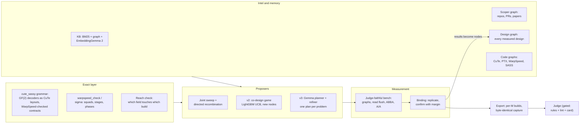

# Automating GPU kernel co-design: exact layers, measured search, and language-model planners

*From TG4DAC to v3, on NVIDIA H200 · Open Kernel Challenge (`muse_moe_w4a16`, `muse_decode_layer`) · November 2026*

**Evidence tags:** **[M]** measured on hardware · **[D]** derived exactly (from source, compiled SASS or a checker) · **[E]** estimate.

---

## Summary

We built a system that designs, builds and measures GPU kernels largely by itself, and we used it to compete in an
open kernel challenge on a single NVIDIA H200. This document describes the **approaches** we found along the way.
Results show up only where they show why an approach works or doesn't.

The system has six layers, and each one turned out to matter for a different reason:

1. **An exact layer.** CuTe layout algebra and WarpSpeed accounting say *which kernels can exist* before anything is
   compiled.
2. **Proposers.** A joint sweep, a LightGBM-guided search game, and a Gemma 4 planner/refiner pair suggest *which
   kernels to try*.
3. **A measurement oracle.** It copies the judge's timing method and decides *which kernels are faster*. It's the only
   thing allowed to make that call.
4. **Composition and export.** This turns the winners into one submission file, per problem size, byte for byte.
5. **Code graphs and retrieval.** They give the proposers (and us) the whole history of what was tried, plus the
   relevant hardware and library facts.
6. **An operating loop.** OODA-style briefs, after-action reviews, an intel map and hard gates keep the whole thing
   honest and pointed at the largest measured loss.

The most important lesson, stated plainly: **models propose and measurements decide.** Every gain that held up on the
judge came from an exact layer narrowing the space and paired hardware measurements choosing within it [M]. The
language models became useful once the exact layer could tell them, precisely, when a plan could not work.

---

## 1. The problem

The challenge asks for a faster version of one layer of an open mixture-of-experts (MoE) model, timed on one H200
against SGLang's own kernel.

| | |
|---|---|
| **Operator** | Routed experts: route tokens to 8 of 256 experts, gate/up projection, SwiGLU, down projection, per-expert normalization, weighted combine. Each GPU owns 32 experts. |
| **Weights** | NVFP4: 4-bit E2M1 codes, an E4M3 scale per 16 values, an FP32 scale per expert. The rules allow lossless repacking but no change of precision. |
| **Loads** | Six token counts, each scored separately: decode 1, 16 and 32 tokens; verify 8, 128 and 256 tokens. |
| **Score** | The geometric mean over the six loads of SGLang's time divided by ours. |
| **Judge** | CUDA-graph replays with a cold L2 cache, checked against an FP32 reference. Final standings come from reruns on held-out data. |

Three things make the problem hard, and they shaped every approach below.

- **It's a compound kernel.** Routing, two GEMMs, an activation, a normalization and a reduction all live in one
  persistent kernel, so one change can help one stage and hurt another.
- **The six loads want different kernels.** One token is pure weight streaming, a memory-bound GEMV. At 256 tokens the
  work is closer to a tensor-core GEMM. The fast design at one size is often slow at another.
- **The noise is about as big as the gains.** Late in the work, real improvements were 0.5–2% per load. Run-to-run
  noise was ±1% per load on a 4-seed screen and ±1.5% on the judge's score [M]. Any method that trusts one
  measurement will chase noise.

---

## 2. The system at a glance



The arrows show the order. Information flows into the proposers. Everything a proposer suggests has to pass the exact
layer, then the bench, then a binding rule. Only then does it become a submission. Every measurement, good or bad, goes
back into the design graph.

---

## 3. Where it started: TG4DAC

Before this challenge we ran **TG4DAC**: small language models co-designing GPU kernels with a frontier model as the
implementer. It ran on an RTX PRO 6000 Blackwell (SM120). It set the pattern that v3 later copied.

| Role | Model | What it does |
|---|---|---|
| **Planner** | Gemma 4 31B + `cake_scoped_c1` adapter | Reads the starting kernel (source, timings, compiler data) and proposes what to change. It's the lineage that ran real CuTe layout algebra (PyCuTe) while planning. |
| **Refiner** | Gemma 4 31B + `refiner_ws1` adapter | Turns the plan into a **WarpSpeed** design: squads of warps, staged shared-memory buffers, phases, barrier counts and register budgets. It checks each plan with a typed `warpspeed_check` tool and fixes what fails. |
| **Implementer** | Claude | Writes the kernels from the plans and measures them against the starting kernel in the same run. |

The refiner was trained on 30 worked examples with real tool runs: CCCL's own WarpSpeed kernel, user-written MLP
kernels, and others. Attention was held out. Built as written, its designs for Gemma 4 attention were the fastest
kernels we measured there [M]:
- 4.6× vLLM's kernel on sliding-window prefill and 3.1× on global prefill;
- up to 3.6× on decode;
- 1.30× end-to-end decode inside vLLM at 8 × 32k context.

**What carried over, and what didn't.** The *roles* carried over: planner, refiner against an exact checker, and
measurement. So did the idea of a **typed checker the model can call** that answers "pass, with every derived number"
or "the first violation, as a counterexample". What didn't carry over was the assumption that a good plan written by a
model is usually faster. TG4DAC started from vLLM's kernels, which left a lot of room. The MoE challenge started from a
kernel that was already 2.36× SGLang, where almost every reasonable plan is slower [M].

---

## 4. The exact layer: what can exist, before anything compiles

The cheapest kernel to reject is the one you never build. The exact layer is a set of checkers. Each answers a yes/no
question with no measurement and no model.

### 4.1 CuTe: decoder graphs as layouts

In an NVFP4 kernel, every 4-bit weight is decoded into a 16-bit value before the math. How the bits are packed in
memory, and which bit tricks turn them into BF16 pairs, is a design choice with a huge number of options. Codex's
**cute_sassy** framed the decoder as a GF(2) bit map, a CuTe `Layout((2,)*32, …)` with F2 strides, and proved
correctness by layout composition [D].

- The raw space is **5,989,005** decoder combinations. Exact pair-compatibility joins on the GPU reduce it to
  **1,816 legal graphs in 1.3 ms** [M].
- Every legal graph comes with its own lossless weight-packing transform, so `prepare()` can repack the weights to
  match.

**Where this paid off:** the decoder was a real lever. One graph (`1246039045:0`), combined with a grouped HFMA2
dequant, gave the single biggest late gain on the one-token load (below). It could only be searched because the space
of legal graphs was finite, exact and enumerable.

### 4.2 WarpSpeed: warp specialization as checkable accounting

**WarpSpeed** (NVIDIA CCCL, `cub/detail/warpspeed`) describes a warp-specialized kernel as squads (groups of warps) that
pass shared-memory buffers through a ring of stages, each stage moving through phases guarded by barriers. We used it
in three places, always as *accounting* (counting resources and checking rules), never as a performance model:

- **The refiner's language** (TG4DAC, v3). Plans are written as squads, resources and phases, so a diagnostic like "this
  phase has no owner" maps straight to an edit.
- **cute_sassy's contracts.** The ownership and pipeline choices for the large-batch build were written as WarpSpeed
  plans, and **1,062** legal contracts survived the check [D].
- **The game's sigma layer.** Every node in the v2 game is rewritten as a WarpSpeed plan. A node fails if
  `warpspeed_check` finds a violation (stage count, barrier arity, the register cap). The plan's derived numbers, such
  as register cap, warps per scheduler, bytes in flight and a stream-rate bound, become features for the learned
  ranker.

**Where this paid off:** the FF1→FF2 handoff in the one-token build is a cross-CTA phase wait, and eight warps were each
polling the same flag. Phrased as a WarpSpeed phase-ownership question ("who owns this wait?"), the fix is one owner
per CTA that releases the squad through a named barrier. That gave **+2.2%** on the one-token load [M] and became a
reusable library move.

### 4.3 The reach check: which knob touches which build

The kernel ships several compiled variants ("builds"), and each serves a range of token counts M. That gives a simple
exact question with large consequences: **does this design change the build that serves this load at all?** We derived
the map from the lowering code:
- `dispatch` only moves the cutoff where the large-batch build takes over;
- ownership, pipeline and workmap only exist in the large-batch build;
- compute and activation only exist in the one-token program build;
- the decoder reaches everything.

**Why it mattered:** before this check, 8 of 9 screens in one Gemma round measured designs that left their own target
build *byte-for-byte unchanged*. Those designs still "moved" their load by −1.4% to +1.4% [M]. That's pure noise, and it
looked like progress. After the check, no-op plans are sent back to the refiner with an exact diagnostic, and the
refiner usually repaired them [M].

### 4.4 Compile and SASS as exact gates

Compilation itself is a checker. In the v2 game, candidates compile on CPU containers first:
- a compile error is an exact contradiction;
- a build whose SASS is identical to its parent's is an exact no-op, recorded as such and never timed.

Over 325 archived designs ingested as starting points, this caught 38 no-ops and 18 contradictions before any GPU
time [M]. Compiled SASS also gives exact features (instruction counts by opcode, registers, spills) for the ranker.

---

## 5. Measurement is the source of truth

Every approach in this document depends on one thing: a bench whose numbers match the judge's. Most of our early
mistakes were measurement mistakes.

### 5.1 Copy the judge's method, then check the copy

The bench replays each kernel in a CUDA graph, makes L2 cold before every replay by **reading** a 256 MiB buffer, times
in **ABBA pairs** against the frozen parent kernel, and runs an **A/A control** (the parent against itself) in every
session.

**The oracle was wrong once, and the search caught it.** Our first bench made L2 cold with a *write*
(`buf.add_(1)`). The judge *reads*. The write left L2 full of dirty lines, and every timed kernel paid for their
write-back, 5–11 µs per replay. That flipped which designs looked best [M]. The fix was to flush the way the judge
does. We now **calibrate every new bench against judge numbers** for the same file before trusting it. For example, the
projection bench's cuBLAS times matched the judge's SGLang times within 0.5 µs [M].

**Subtract the fixed cost.** A CUDA-graph replay of an empty kernel costs about 16–19 µs on our bench [M]. Comparing
raw times of µs-scale kernels without subtracting it hides most of the difference.

### 5.2 Know the noise floor, and design for it

| What we measured [M] | Noise |
|---|---|
| A 4-seed screen of a design whose target build is identical to the champion's | ±1% per load, sometimes ±1.4% |
| A 12-seed × 2-repeat comparison on the one-token load | about ±1.5% |
| The judge's six-load score, the same file submitted again | about ±1.5% |

The consequences became rules:

- **Screens find candidates; confirms decide.** A 4-seed screen only nominates. A design takes a title only after a
  12-seed × 2-repeat run *next to the champion in the same session* beats it by a margin (0.3% per load). In one round, a
  screen showed +0.64%, and the confirm shrank it to +0.03% [M].
- **The winner's curse is real.** Pick the best of 30 noisy measurements and it reads high. Re-measure the winner before
  believing it.
- **Measure only what can move.** A problem-specific screen times only its own load, at 12 seeds instead of 4 seeds on
  all six, for about half the cost.

### 5.3 Parity of the exact file you'll submit

A design measured inside a search harness isn't the same object as a submission file. We export submissions by
**capturing the exact lowering**. A stub compiler records every build's source and flags. The submission rebuilds the
same strings, and all builds are checked to be **byte-identical** [D]. Then a parity bench times the exported file
itself against the parent. For our main submission, parity predicted +1.65% over the previous best and the judge
measured +1.9% [M].

---

## 6. Proposers: three ways to decide what to try

All three proposers feed the same exact layer and the same bench. They differ in how they choose.

### 6.1 Joint sweep and directed recombination

The simplest proposer worked best at the start. We drew designs jointly from the whole cute_sassy grammar (compute
family × activation × ownership × pipeline × dispatch × workmap × decoder), rejected illegal ones by contract, compiled
the rest on 64–128 CPU containers, and screened every one on several H200s. The leaders then went through halving rounds
at 12 × 2.

The approach that turned this into a win was **directed recombination**: take the measured pieces and build their
combinations exactly.
- Grouped HFMA2 dequant alone: **+0.4%** on the one-token load.
- Decoder `1246039045:0` alone: **+0.9%**.
- **Both together: +3.3%** (12 × 2, paired) [M].

The pieces interact, and no single-change search would have found it. Stacked with the handoff move, it was banked on
the judge at **2.4059×**, up from 2.3620× [M].

### 6.2 v2: the co-design game, with LightGBM

v2 treats design as a game played over a tree of designs.

- **Trees.** One tree per (starting design, build). Moves are compile-time knobs in that build, and constructors that
  add new knobs each round (a "new node" is a design nobody has measured).
- **Backward admissibility.** A move may enter a tree only if its mechanism class owns at least 0.5% of that load's
  time in a measured time table. This keeps the search pointed at real losses.
- **Selection.** A bootstrap ensemble of LightGBM regressors per tree predicts each frontier node's value. The game
  measures the nodes with the highest upper confidence bound (mean + κ·spread). Features include the knob one-hots,
  the node's WarpSpeed plan numbers (§4.2) and compiled SASS counts.
- **Two-stage evaluation.** Compile about twice as many candidates as you'll time, re-rank them with their real SASS
  features, then time the top half.
- **Binding.** A node becomes a tree's incumbent only with at least 2 samples, a mean above max(3 × the A/A noise,
  0.5%), and no load below −0.5%.
- **Parking.** Moves with an exact witness (a compile error, a hang, SASS identical to the parent) are never proposed
  again. Moves that only lost on their own stay allowed inside combinations, because interactions are where the wins
  were (§6.1).

**What v2 found.** On the large-batch build, the game bound a three-knob node (`GATHB=4, WGSREORD=0, WGSFCI=4`) at
+2.06% summed over its loads [M]. Two lessons came out of moving it to our best kernel:

- **Winners don't transfer automatically.** Measured on top of the banked design, the same knobs still gave +1.0% to
  +1.5% on the 32-token decode load, but cost the 256-token load 0.5–0.7%. Another bound winner (+1.16% on one build)
  reversed to −0.4% [M]. A gain belongs to the design it was measured on.
- **Per-M builds keep a gain without paying for it elsewhere.** We gave the 32-token load its own build with the knobs
  and left the others alone. On the judge that load dropped from 123.0 µs to 121.4 µs, and the other loads stayed on
  identical builds [M].

**v2 + Gemma.** We added Gemma's planner as a node proposer, and the refiner repaired proposals against the game's exact
rules. With only a snapshot of each tree, its nodes all lost [M]. The fix was **context**: the tree's full history,
Gemma's own past proposals with their outcomes, the CUDA lines each knob controls, and measured transfer facts.

**v2 × cute_sassy.** The last version runs v2's engine over cute_sassy's grammar instead of compile-time knobs:
- **Features:** the decoder graph's 32 code bits, which let the model *generalize to decoders nobody has measured*,
  plus field one-hots and SASS counts.
- **Frontier:** all 3,632 legal decoder graphs, every legal ownership × pipeline × workmap, and the neighbours of each
  load's leaders.
- **Seed data:** a 514-design sweep around the champion. In it the champion's own program design ranked #2 of 514 on the
  screen and best at 12 × 2 among 31 finalists, which says it sits near a local optimum of this space [M].

### 6.3 v3: Gemma planner and refiner, one plan per problem

v3 is the TG4DAC pattern pointed at the MoE kernel and run on one H200, with the planner, refiner, compiler and timer
all on the same GPU.

```text
exact layer ─► planner ─► exact check + Dijkstra ─► refiner ─► search ─► auto-generate ─► measure ─► repeat
(cute_sassy)   (Gemma 4 +   (contracts, decoders,     (Gemma 4 +  (open      (constructors,   (judge-faithful,
               CuTe lineage) patches, reach check)     WarpSpeed)  fields)    patches → CUDA)  per problem)
```

- **One plan per problem.** Each of the six loads is its own problem with its own champion, because each is served by
  its own build. That means wins can be combined later as per-M builds.
- **The whole design graph in context.** The planner reads every measured design (about 735 nodes, compactly encoded)
  plus the measured effect of every single-field change.
- **Retrieval.** EmbeddingGemma 2 retrieves the closest design nodes, with their code, and the closest nodes from our
  code graphs (§7).
- **Exact feedback before the refiner.** Contract failures, illegal decoders, patch-gate failures, the reach check
  (§4.3), and a **Dijkstra** path that gives the cheapest legal order of edits from the champion, priced by rebuild cost.
  Every step on that path is a valid kernel, so its midpoints are free matched pairs.
- **Memory.** Each planner sees its own last plans for its problem: the exact verdict, the refiner's fix and the
  measured result.
- **Knobs without restarts.** Sampling temperature lives in a control file reread every round, at 0.2 for careful
  rounds and 0.7 to explore.

**What v3 showed.** The pipeline runs unattended. Plans come back legal, and with the reach check they target real
changes. When the refiner gets an exact counterexample, it usually fixes the plan [M]. What it hasn't done yet is beat
the champion. Every confirmed v3 design tied or lost [M]. The plans also chased noisy leaders in the graph until the
ledger told the planner, in words, which rows are 4-seed screens and which are 12 × 2 evidence.

---

## 7. Code graphs and retrieval

We kept everything as graphs a model or a person can query.

| Graph | What's in it | Size |
|---|---|---|
| **Design graph** | every measured design: field designs, code moves (with patch text), game leaves, judge-scored submissions, the patchable kernel functions; edges for one-field differences, "touches this function", "uses this library move" | about 735 nodes [D] |
| **CuTe graph** | the CuTe layout paper's definitions and theorems, plus the code they map to | 1,106 nodes |
| **PTX graph** | the PTX ISA: instructions, syntax, examples, semantics | 743 nodes |
| **WarpSpeed graph** | CCCL WarpSpeed structs and functions with their docs | 154 nodes |
| **Codesign graph** | rules and facts from earlier co-design games | 617 nodes |
| **SASS stats** | per-kernel SASS of our own kernels: registers, spills, inner-loop opcode mix | 279 nodes |
| **KB** | our briefs, reviews, ledgers, kernels, plus 17,700 chunks from 5,399 public H100 submissions; BM25, a link graph and EmbeddingGemma 2 vectors | 41,685 vectors |
| **Scoper graph** | repos, PRs and papers reached by following README links, mechanism-class PR searches and citers of key papers | 2,442 nodes, 5,809 edges |

**Where graphs helped:**
- **"Did we already try this?"** became a lookup instead of a memory test. The KB found earlier measurements twice
  that we were about to repeat.
- **The design graph's measured single-field effects** told the planner which field moves which load, before we derived
  the exact reach map.
- **WarpSpeed and PTX retrieval** gave the refiner the exact syntax and rules for code moves.
- **The whole graph in one context** made "build on what's measured" possible. It needs a compact encoding to fit:
  every node on one line, per-load numbers as signed percents. That cut the listing by a third.

**Where graphs didn't help:** similarity isn't quality. The nearest node to a question is often a noisy screen or a
design for a different build. Retrieval has to be paired with the evidence weight of each row and with exact checks.

---

## 8. The operating loop: OODA, gates and honesty

The search systems run inside a loop that people, and agents, can audit.

- **A state machine for decisions.** `enter → agenda → brief → check | submit → IAR → …`. Each step refuses to run
  without the previous step's artifact. A brief names the measured loss it targets, the prior art, a falsifier and an
  estimate. An after-action review (IAR) records what happened, what it means and what changes next. Repeated nulls
  trigger an AAR and a reset.
- **A ledger from the judge's numbers.** Rows come from the judge's JSON, never typed by hand.
- **Constraints with sources.** Every constraint is tagged RULE (quoted, versioned), USER (directive, dated) or
  INFERENCE. An inference can't close a branch until it's verified.
- **Hard gates on anything public.** Submissions go only through `ooda.py submit`. It stops unless the live rules
  version matches our saved copy and the file passes a lint for forbidden patterns. Device syncs, streams and graphs in
  the timed call, and measurement scaffolding, never ship.
- **A card before every scarce run.** Parent and score, the measured loss targeted, an estimate *only from a measured
  analog* (else "unknown"), budget used, risk, noise band, information value, and one falsifier. A person approves each
  run.
- **Checks are submissions.** A check run is a prepared shot with a real candidate, not a probe for gaming the board.

**What the loop taught us:**
- **Estimators don't select.** Our time models were optimistic on 30 of 30 predictions one day. Another predicted
  −4.6 µs on a load that measured +15.5 µs [M]. Models are now used to enumerate candidates and derive exact resources.
  They never pick or veto a move.
- **Lessons only work as enforced checks.** A lesson written in a document got repeated. A lesson turned into a gate
  field or a tool rule stopped recurring.

---

## 9. Intel: knowing what the field already knows

We treated intel as a map of who knows what and where they publish, swept when a decision depends on it.

| Actor | Channels |
|---|---|
| Customer (engine maintainers, model owner) | PRs, issues and roadmaps since the judge's pinned commit; the model card; the owner's kernels |
| Competing engines | PRs, release notes and blogs for the exact operators |
| Suppliers (CUTLASS/CuTe, cuBLAS, FlashInfer, DeepGEMM) | repos, release notes, and *which versions are in the judge image* |
| Academia and community | recent arXiv, lab blogs, competition write-ups, public kernels |
| Other competitors | board trajectory, public repos and their measured-facts documents |
| Hardware | microbenchmark papers and our own probes |

Rules we learned the hard way:
- **Never dismiss a source by its label.** A "robotics" project held exactly the one-token GEMV rule we needed.
- **Query by mechanism, across format names.** INT4, MXFP4, NVFP4 and NF4 kernels share the same tricks. A query for
  one name missed a key project.
- **Read the other teams' measured facts.** One team's public H200 notes saved us hours. For example: "12-bit
  in-register weight decode loses at 128+ tokens; the ALU work costs more than the bytes saved." We read them before
  building a projection kernel, and our own measurement agreed: a TMA streaming ring tied cuBLAS but didn't beat it
  without fewer bytes [M].
- **Read primary sources in full.** The rules, not a summary of them. The prize structure, the reruns and the
  priority rule all live in one page.

---

## 10. Composition and export

The last step turns measured pieces into one honest file.

- **Per-M builds.** The kernel picks a build by token count, so a gain that belongs to one load gets its own build for
  that load's M range. It's compiled ahead of time in `prepare()`, never on the timed path.
- **Rule-based export.** Each source transformation (decoder rewrite, large-batch architecture rewrite, handoff patch,
  program build) is applied by the submission's own `load_inline` hook, and every build is checked byte-identical to the
  measured lowering.
- **Embedding in a larger file by syntax tree.** To move the MoE into the full decoder-layer submission, we replaced one
  string assignment through Python's AST, checked that nothing else changed, and verified the embedded file's hash. The
  layer went from 1.637× to 1.650× on the judge, with the gain on the loads we predicted [M].

---

## 11. What we learned

1. **Exact first, then measure, then let models help.** The exact layer (CuTe decoders, WarpSpeed contracts, compile and
   SASS identity, the reach map) removed most of the space for free. Measurement decided everything that was left.
2. **Interactions are where the gains hide.** The biggest late gain came from two pieces that were small alone. Keep
   "lost alone" moves available inside combinations, and recombine measured pieces on purpose.
3. **A gain belongs to the design it was measured on.** Re-measure every transferred win on the target. Per-M builds
   let you keep a load's win without paying for it on the others.
4. **Design the method around the noise floor.** Screens nominate, confirms decide, winners get re-measured, and a title
   needs a margin. Measure only what can move.
5. **Check whether a change can reach its target at all.** It's the cheapest check there is, and without it a search
   happily measures noise.
6. **Language models need exact feedback and evidence weights.** Given a counterexample, the refiner fixes plans. Given
   a graph without evidence tags, the planner chases lucky screens. Give them their own history and outcomes.
7. **Bytes beat loads once you're at the roofline.** A good TMA ring matches cuBLAS. Beating it on memory-bound shapes
   needs fewer bytes (lossless compression), not a better loader.
8. **Instruments need watching too.** The one time our oracle was wrong (a write flush instead of a read), it silently
   reordered the leaderboard of designs.

---

## 12. What's next

- **WarpSpeed as the constructor language.** Write new structural moves directly as squads, phases and resources, so
  they're generated, checked and lowered by the same loop: fused FF1→FF2 stages, warp-specialized producer splits,
  cross-CTA phase ownership.
- **Learned proposers over exact frontiers.** The v2 × cute_sassy setup (LightGBM over decoder bits and SASS features)
  scales to the full legal space cheaply. Pair it with Gemma as a source of *new constructors*, not new knob values.
- **Measure the planner's value fairly.** Compare Gemma's proposals against the LightGBM ranker and a random legal
  sampler at matched compile and GPU budgets.
- **Serving.** Port the measured kernels into the serving engine, where the remaining time sits in attention,
  projections and glue.

---

## Appendix A. Glossary

| Term | Plain meaning |
|---|---|
| **Load** | One scored token count (decode 1/16/32, verify 8/128/256). |
| **Build** | One compiled variant of the kernel; the kernel picks a build by token count M. |
| **Decoder graph** | The exact recipe of bit operations that turns packed 4-bit weights into 16-bit values; one of 1,816 legal recipes. |
| **CuTe layout** | A function from coordinates to memory offsets; here, a bit-level map proven correct by composition. |
| **WarpSpeed squad / stage / phase** | A group of warps with one job / one slot of a shared-memory ring / one step of that slot's life, guarded by a barrier. |
| **Contract** | A legal ownership-and-pipeline plan for the large-batch build, checked by WarpSpeed accounting. |
| **Screen / confirm** | A quick 4-seed measurement that nominates / a 12-seed × 2-repeat measurement next to the champion that decides. |
| **A/A control** | The reference kernel measured against itself, to read the noise. |
| **No-op** | A design whose compiled code for the build in question is identical to the champion's. |
| **Binding** | The rule that turns a measured node into a tree's new incumbent. |
| **Per-M build** | A build that serves only one load's token range, so its gain doesn't touch the other loads. |
| **IAR / AAR** | The review after each run / the deeper review after repeated nulls. |

## Appendix B. Where things live

| Component | Path |
|---|---|
| cute_sassy (exact grammar, decoders, contracts) | `garage/cute_sassy/` (snapshot in `garage/posse_20261104/snap/`) |
| Joint sweep, directed recombination, per-problem sweep | `garage/posse_20261104/posse.py` |
| v3 pipeline | `garage/posse_20261104/gemma_v3.py`, `patch/posse_v3lib.py`, `design_graph.py` |
| v2 co-design game (+ Gemma stage) | `garage/codesign_game_claude_20261103/r1_modal/game.py`, `gemma_game.py`, `sigma.py` |
| v2 × cute_sassy (LightGBM over the grammar) | `garage/posse_20261104/cs_game.py` |
| Benches (parity, multi-file parity, projections) | `garage/posse_20261104/parity*.py`, `proj/posse_proj_bench.py` |
| Export and composites | `garage/posse_20261104/export_rules.py`, `make_composite.py`, `layer/build_layer_c1.py` |
| TG4DAC (planner/refiner/implementer, WarpSpeed checker) | `garage/TG4DAC/deneb/` |
| OODA harness, rules gate, lint | `garage/okc/ooda/`, `garage/okc/PLAYBOOK.md` |
| Intel, KB, scoper, code graphs | `garage/okc/intel/` (kb, scoper, graphs) |
| Design formulation documents | `base/formulation.md`, `base/codesign_game.md`, `base/cute_sassy.md` |

## Acknowledgments

vjeux (base kernels the field built on, Apache-2.0), Matsvei (the per-thread context-bind helper used in our
submission), NVIDIA CCCL (WarpSpeed) and CUTLASS/CuTe, the team whose public H200 measured facts we cite, and GPU MODE,
whose reference kernels the judge was built from.
