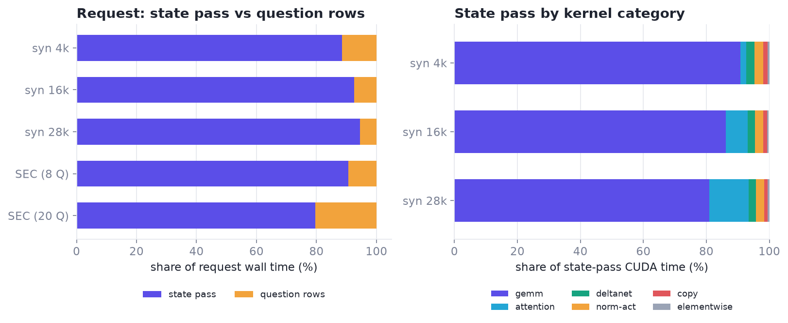
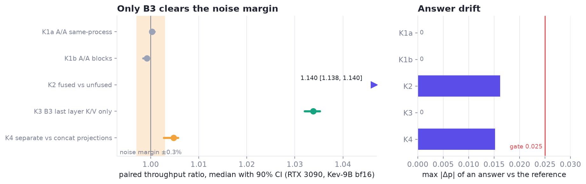

# Prefill on consumer cards: a decision model on sm_86 and sm_89

November 5, 2026 · one RTX 3090 (sm_86, 300 W cap) for paired runs, RTX 6000 Ada (sm_89) for the FP8 path ·
[Kev](#kev), a Qwen3.5-hybrid decision model run prefill-only

The workload scores long documents. A request is one **state** (a document of about 28k tokens) plus up to ten
short **questions**. The state is run once; each question then runs as a **row** that reads the state's cached keys,
values and DeltaNet state without changing them. The job is compute-bound, the GPUs are already 100% busy, and the
code is all prefill.

One profile reshaped the work. The largest bf16 GEMM already ran at about **95% of the 3090's peak**, so there was
no tuning headroom in the matrix multiplies. The gains came from structure:

- **1.140×** for fused kernels against the unfused path (sets the reference drift) [M];
- **1.0338×** for computing only the last layer's keys and values in the state pass, with identical answers [M];
- a **null** for concatenated against separate projections [M];
- **1.12×** for fused kernels under FP8 on Ada [M], but FP8 amplified their rounding drift past the answer gate.

Run ids are in [`kev_prefill_runs.csv`](../../data/kev_prefill_runs.csv); the analysis replays on CPU in
[notebook 12](../../notebooks/12_prefill_on_sm86_sm89.ipynb). **[M]** marks a hardware measurement.

## The workload and the bench

| | Production | Bench |
|---|---|---|
| Model | Kev-27B, FP8 at load time | Kev-9B, bf16 (the closest model that fits 24 GB) |
| Cards | 2 × RTX 6000 Ada, 300 W cap | RTX 3090, 300 W cap |
| Requests | ≈ 28k-token states plus ≤ 10 questions | the same bundle: 8 requests, ≈ 29k tokens each, 78 answers |
| Speed | ≈ 1,500–1,850 input tokens per GPU-second | 3,642 tokens/s fused (K1a) [M] |

Every number below is tokens per GPU-second. The 3090 cannot run FP8: on sm_86 the FP8 loader warns and dequantizes
to bf16. The Hopper features used by the H200 work are absent on both cards (see
[what did not transfer](#did-not-transfer)).

<a id="measuring"></a>
## Measuring on cards you cannot isolate

The protocol is the paired one from the [measurement contract](../getting-started.md#measurement): candidate and
reference alternate (ABBA), an A/A control runs first, and a change counts only if the 90% interval of the paired
ratio clears a margin. A whole prefill pass takes 7–8 s, so CUDA graphs, the L2 flush and the null replay do not
apply; [`LongBench`](../../xcalibur/bench.py) keeps the pairs and adds what long calls need. Consumer cards added
four problems.

**A/A is not exactly 1.** Both controls exclude 1.0 from their intervals, but the offsets are tiny [M]:

| Control | Run | Median ratio [90% CI] |
|---|---|---|
| Same process (reload-free) | `…091828Z-c0c919` (K1a) | 1.0003 [1.0001, 1.0008] |
| Blocks (reloads) | `…092531Z-2ee1bc` (K1b) | 0.9992 [0.9984, 0.9994] |

The rule became: adopt only if the interval's lower bound is above 1.002 (same process) or 1.003 (blocks), at least
twice the worst offset. [`aa_margin`](../../xcalibur/stats.py) encodes that rule.

**Blocks versus same process.** Two Kev-9B copies do not fit in 24 GB, so most comparisons reload the model between
blocks, and the two sides of a pair sit a whole pass apart. That is why blocks carries the wider margin. Anything
that reads an environment variable at call time must run in blocks.

**The power cap moves the clock.** The card ran at its 300 W cap. The SM clock sat at 1,695 MHz and dipped to
1,335–1,350 MHz at the end of some blocks (K2) [M]. Alternating pairs cancel slow drift; a one-sided run would not.
`LongBench` records an nvidia-smi snapshot per block so the drift can be checked rather than assumed.

**The warm-up that ran out of memory.** The fused model ran out of memory on the 24 GB card while Triton autotuned
the fused SwiGLU on a 28k-token state (weights 16.5 GB). Warm-up now runs a state of at most 2,048 tokens first
(`small_first`); the tuning keys do not depend on length, and a 28k pass then peaks at 20.95 GB (FIX1) [M]. A fresh
server whose first request is a 28k state can hit the same spike.

**Resample requests, not repeats.** The 16 pairs come from only 8 requests, so the interval is a cluster bootstrap
over request ids (`bootstrap_ci(ratios, clusters=request_ids)`). Resampled one ratio at a time, repeats of one input
look like independent evidence and the interval is too narrow. With so few clusters, read each interval as a bound
on the bench, and confirm on the full bundle before a production claim.

## The profile: the GEMMs were already at peak

Before changing a kernel we profiled it (B1).



| Measured on the 3090 [M] | |
|---|---|
| State pass share of a request, 28k-token state, 8 questions | 90.6% (7.62 s) |
| The same, 20 questions | 79.6% |
| Synthetic 28k state, 6 questions | 94.5% |
| State pass at 28k: GEMM / attention / DeltaNet / norms / copies | 81 / 12.5 / 2.3 / 2.5 / 1.2% |
| Gate and up projection alone | 37.5% of the state pass, at about 67 TFLOPS |

The 3090's dense bf16 peak with fp32 accumulate is 71 TFLOPS, not 142: GeForce boards run that path at half rate
(`ARCHS["rtx3090"].bf16_tflops_dense`, sourced from the GA102 whitepaper [[GA102](../references.md#ga102)]). A hand
check agrees: 28k × 4096 × 24576 × 2 FLOPs in 84 ms. So **the state-pass GEMMs had no tuning headroom**; only a
lower-precision format moves them. State attention is PyTorch flash at about 54 TFLOPS, so a better kernel there is
worth at most 1–2% of a request.

The prior estimate (GEMM 70, attention 19, DeltaNet 6%) was wrong: measured, it is 81, 12.5, 2.3. The question rows
look different [M]: attention 34% (masked rows fall back to a memory-efficient kernel that underfills the GPU),
cache copies about 27%, GEMM 36%. The GPU is 92–95% busy, so rows are not launch-bound and CUDA graphs are worth
under 1%.

Three lines of work followed: remove state-pass work nobody reads (B3), stop rows from copying and re-reading the
state (B4), and make the fused kernels usable under FP8 (B2).

## Each change, paired



| Change | Run | Paired ratio, median [90% CI] | Numerics vs reference |
|---|---|---|---|
| Fused vs unfused (K2) | `…093322Z-225cff` | 1.1398 [1.1380, 1.1402] | max \|Δp\| 0.0162, 2/78 flips |
| B3, last layer K/V only (K3) | `…094147Z-714278` | 1.0338 [1.0320, 1.0352] | exact: \|Δp\| 0, 0 flips |
| Separate vs concat projections (K4) | `…094833Z-2a2644` | 1.0048 [1.0027, 1.0057] | max \|Δp\| 0.0152, 0 flips |
| B4, rows in one pass (K5) | pending | pending | pending |

All use blocks mode, 16 pairs, Kev-9B on the 3090 [M].

**Fused kernels (K2).** Production runs the unfused path. The fused path (fused SwiGLU, DeltaNet, norms) is 1.140×
faster by the per-request median, 3,041 to 3,625 tokens/s. The token-weighted ratio, 1.192× [1.138, 1.303], is pulled
up by one long request, so the median is the headline. Production's `kernels` 0.16 package leaves the unfused path
unchanged: probabilities are bit-identical and times differ by under 0.5% (ENV1) [M].

**B3: skip the last layer's dead work (K3).** A state pass needs only the cache, never the last layer's output. B3
computes only that layer's keys and values and skips its attention, output projection, MLP and final norm. It is
exact by test: on real Kev-4B weights at a 3,953-token state, 32 of 32 cache layers are `torch.equal`. One layer of 32
is 3.1% of the stack; the paired run measured 1.0338× (3,638 to 3,759 tokens/s) with identical answers [M]. The lower
bound clears the 1.003 margin, so it was adopted. On the 64-layer 27B model the expected gain is about 1.5%, an
expectation until Ada measures it.

**K4: concatenated against separate projections is a null.** Making FP8 work cost one trick. `fuse()` concatenated
the DeltaNet in-projections (`in_proj_qkv`, `z`, `b`, `a`) into one matrix, but the FP8 loader converts only `qkv`
and `z`, so B2 calls the projections one by one when the dtypes differ. K4 prices that in bf16: 1.0048×
[1.0027, 1.0057]. The lower bound is below the blocks margin of 1.003, so **there is no measured difference**. The run
table's automatic decision said ADOPT because it compared against the same-process margin of 1.002; the ledger
applies the margin of the mode that ran and records a null. It fits the profile: the tiny `b` and `a` projections
cost about 0.3 ms each per state pass (0.09%) [M]. Concatenation stays the default for plain bf16. The null is kept
because the next person will try the same idea.

**B4: question rows in one pass.** Each row used to copy the whole cache (about 0.94 GB) and replicate K/V for
grouped-query attention. B4 does two things:

1. **No copies (always on).** Attention layers read the cached K/V through an expanded view, and masked attention
   uses grouped-query mode. On two requests (28 answers) the output was bit-identical; request times 7,629 and
   8,170 ms became 7,553 and 7,948 ms [M].
2. **Rows packed into one pass** (off until K5). All rows of a request run as one packed sequence. Each row's
   attention has two pieces merged exactly by their log-sum-exps $`\ell`$: unmasked flash over the shared state, and
   causal flash over the row itself,

```math
o = \frac{e^{\ell_1} o_1 + e^{\ell_2} o_2}{e^{\ell_1} + e^{\ell_2}}.
```

DeltaNet layers use per-row copies of the state's recurrent state that are never written back. An unpaired screen
(one model, flag toggled) showed rows falling from 718 to 612 to 297 ms with 8 questions and from 1,666 to 1,430 to
603 ms with 20; whole requests improved 5% and 12.5%. Rows are then 72% GEMM with the GPU 98.5% busy [M, screen]. On
78 answers the one-pass output differs from per-row by max |Δp| 0.0127 with 1 flip, a near-tie. **The paired ratio,
its interval and the 599-answer numerics (K5) are pending.**

<a id="fp8-on-ada"></a>
## FP8 on Ada

Production runs FP8, which the 3090 cannot, so B2's real test is on the Ada card (ADA1) [M]: one card, Kev-27B FP8,
the smoke bundle, HTTP replay at concurrency 2, with the other card serving.

| | tokens/s |
|---|---|
| E0: FP8, unfused (production today) | 1,987 |
| E2: FP8 + B2, fused | 2,231 (repeat 2,246) |

That is **1.12×**, and the repeat lands 0.7% from the first run. It agrees with the 3090's bf16 1.14× (K2).

**But the answers moved more than in bf16** (ADA2) [M]. On the same 599 answers, E2 against E0: max |Δp| 0.0725,
27 argmax flips (4.5%), 97.8% within one level (13 answers moved two or more levels), mean |Δlevel| 0.044, about six
times the bf16 drift of K2. Both paths are deterministic (E2 against a repeat of itself, and E0 against production's
stored answers, are bit-identical), so this is a real difference, not noise. Against human-proxy labels the error is
unchanged (MAE 1.064 against 1.065, difference 95% CI [−0.007, +0.006]): different answers, not worse ones. It still
fails the [gate](#answer-gate), so production stays unfused.

The likely mechanism: the fused norms keep fp32 where the reference rounds to bf16; a one-ulp difference moves an
activation into a different FP8 bucket under per-128-group dynamic quantization, and 64 layers compound it. A bf16
screen with per-row fake FP8 could not show this. Pending: the full dev set (3,265 answers), the fix (round where the
reference rounds, under FP8 only), B3 on Ada, and an FP8 profile.

## Lower precision for the GEMMs

Since only a cheaper format moves the state-pass GEMMs, two kits study that directly:

- **[`fp8_block_sm89`](../../kernels/fp8_block_sm89/README.md)** asks how far production's block-FP8 Triton GEMM is
  from what the Ada card can do, and how much of the gap closes without changing an output bit. A probe put stock at
  150–162 TFLOPS at 28k tokens against a practical ceiling near 210 TFLOPS [M]. The kit runs the
  [measured game](../search.md#measured-search) per (N, K) with M buckets as loads, one build per bucket. Restricted
  to builds that are bitwise equal to stock, its 21-entry table made a full production replay ×1.05 faster (three ABBA
  pairs, ×1.049–1.052) with every answer bit-identical [M].
- **[`w8a8_sm86`](../../kernels/w8a8_sm86/README.md)** puts INT8 W8A8 linears on the 3090, whose INT8 tensor rate is
  four times its bf16 rate. It measured 2.81× on a state pass's projections and 1.84× end to end; SmoothQuant and
  per-128 activation scales held 1.81× at about half the drift [M]. Nothing measured passes the answer gate, so it is
  not adopted.

<a id="did-not-transfer"></a>
## What did not transfer from the H200 work

| Piece | Why it is not used here |
|---|---|
| WarpSpeed plans with `wgmma`, TMA and `setmaxnreg` ([formulation](../formulation.md#warpspeed)) | These are Hopper features, absent on sm_86 and sm_89; `warpspeed_check(..., arch="rtx3090")` rejects them with a counterexample. Plans built from `cp.async` plus mbarrier rings feeding `mma.sync` do apply: that is the shape of TG4DAC's SM120 attention kernel, and its shared-memory budget fits the 99 KB per-CTA limit of both cards. They were not used because the profile shows no bf16 GEMM headroom, and attention is 12.5% of the state pass on the 3090. Under FP8 on Ada, attention's share grows if the GEMMs speed up, which is when a ported attention plan becomes worth measuring. |
| NVFP4 | Only Blackwell has FP4 tensor cores. Whether a W4A4 path can serve this model is an open question. |
| Weight-only decoders ([GF(2) packing](../formulation.md#gf2)) | They shrink memory traffic, which helps decode. Prefill is compute-bound and weight-only formats unpack to bf16 for every multiply, so they are expected to be slower here. Not yet measured. |

What did transfer is the method: the paired bench, A/A controls, a margin set from the noise, and an append-only
ledger that records the nulls too.

<a id="answer-gate"></a>
## The answer-drift gate

A faster kernel is worth nothing if it changes answers. Production's bar for numerics-only changes is at least 97%
exact argmax, at least 99.5% within one level, and a mean signed bias under 0.03. The bench's default rule (at most
0.5% flips) was stricter than the drift between fused and unfused kernels, which K2 measured: 2 flips in 78 (2.6%),
both to an adjacent level, 100% within one level. Applying that rule would reject the baseline. So the gate was
calibrated from the reference drift [M] and agreed with the workload's owner:

| Gate for later numerics-only changes | Limit | K2 (sets it) | K3 | K4 |
|---|---|---|---|---|
| Within one level | 100% | 100% | 100% | 100% |
| \|Δp\| p99.9 | ≤ 0.024 | 0.0157 | 0 | 0.0152 |
| \|Δp\| max | ≤ 0.025 | 0.0162 | 0 | 0.0152 |
| Flip rate | ≤ 2.6% | 2.56% | 0 | 0 |

78 answers cannot tell 2 flips from 3, which is why B4 is re-measured on the full smoke bundle (599 answers) before
any claim.

## Takeaways

- **Profile before tuning.** One profile showed the GEMMs at about 95% of peak, and the search moved to structure.
- **Structure paid:** a dead layer (+3.4%), a shared state (rows 2.4–2.8× faster in the unpaired screen), and a
  fused path made to run under FP8 (+12% on Ada, not yet within the answer gate there).
- **Set the margin from your own A/A**, and use the margin of the mode you ran.
- **Gate numerics from the reference drift**, not from a number picked in advance.

## Files

| Path | What |
|---|---|
| [`data/kev_prefill_runs.csv`](../../data/kev_prefill_runs.csv) | Run ids, paired ratios, intervals, margins, drift and decisions |
| [`data/kev_prefill_profile.csv`](../../data/kev_prefill_profile.csv) | Request split and state-pass category shares per workload |
| [`notebooks/12_prefill_on_sm86_sm89.ipynb`](../../notebooks/12_prefill_on_sm86_sm89.ipynb) | CPU replay of the figures above |
| [`xcalibur/warpspeed.py`](../../xcalibur/warpspeed.py) | `ARCHS` for sm_86 and sm_89 boards and their counterexamples |
| [`xcalibur/bench.py`](../../xcalibur/bench.py), [`xcalibur/stats.py`](../../xcalibur/stats.py) | `LongBench`, clustered `bootstrap_ci`, `aa_margin` |

The model, its serving harness and the run bundles are not distributed here.

## References

- <a id="kev"></a>**[Kev]** J. Palmer. *Kev.* A Qwen3.5-hybrid decision classifier. [link](https://github.com/jaredpalmer/kev)

[Studies](../studies.md#sm86-sm89) · [Documentation](../README.md) · [References](../references.md)
