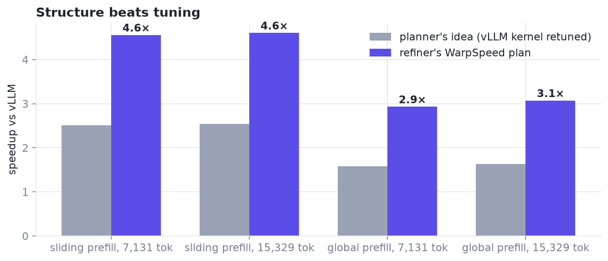

# TG4DAC kernels on RTX PRO 6000 Blackwell (SM120)

The kernels from TG4DAC, where small language models planned GPU kernels for Gemma 4 31B and a frontier model
implemented the plans as written ([chapter 1](../../docs/01-tg4dac.md)). Each file is a self-contained benchmark:
it builds the incumbent, the speed-of-light bound and every implemented design, checks them against a reference, and
times them in the same run.



## `attention.py`: attention, a held-out problem

Gemma 4 31B attention, per layer, against vLLM's Triton attention kernel. Attention was **held out** of the
refiner's training, so these designs are its work on an unseen operator.

$$
o_h = \operatorname{softmax}\!\big(q_h K_{g(h)}^{\top}\big)\, V_{g(h)}, \qquad
\begin{cases}
\text{sliding: } 32\ \text{Q} / 16\ \text{KV heads},\ d = 256,\ \text{last } 1024 \text{ positions}\\
\text{global: } 32\ \text{Q} / 4\ \text{KV heads},\ d = 512,\ \text{all positions}
\end{cases}
$$

| Design | Origin | Idea |
|---|---|---|
| Launch constants (prefill) | planner | vLLM's kernel unchanged, run with the planner's tile and launch choices |
| Window trim (sliding decode) | planner | re-base each sequence on the first cache page its 1024-token window touches, so vLLM's kernel stops scanning evicted pages |
| V-only cache (global decode) | planner | cache only $V$ and rebuild $K = \operatorname{RoPE}(w_k \odot V)$ in the kernel; for the 384 unrotated dims $K\cdot q = V\cdot(w_k \odot q)$, so $w_k$ folds into $q$ and every cached byte is read once |
| WarpSpeed prefill | refiner | a load squad streams Q and K / V through `cp.async` + mbarrier rings into a compute squad running `mma.sync` m16n8k16 |
| WarpSpeed decode | refiner | one load warp fills a KV page ring for three compute warps, window bounds in-kernel (sliding); a 4 + 4 warp split over a V-only ring (global) |

Measured against vLLM in the same run [M]: **4.6×** on sliding-window prefill, **3.1×** on global prefill, up to
**3.6×** on decode, and **1.30×** end-to-end decode throughput at 8 sequences × 32k context inside vLLM. Data:
[`data/tg4dac_attention.csv`](../../data/tg4dac_attention.csv), [`data/tg4dac_e2e.csv`](../../data/tg4dac_e2e.csv).

```bash
python attention.py --B 1 8 --L 4096 32768 131072 --prefill-M 7131 15329
```

## `mlp.py`: the dense 4-bit MLP with a LoRA adapter

The first TG4DAC round: a dense W4A16 MLP (INT4, group-32 scales) with a rank-16 LoRA on every projection,

$$
g = XW_g^{\top} + 2\,(XA_g^{\top})B_g^{\top}, \quad u = XW_u^{\top} + 2\,(XA_u^{\top})B_u^{\top}, \quad
Y = \big(\operatorname{GELU}(g) \odot u\big) W_d^{\top} + 2\,(\cdots)A_d^{\top}B_d^{\top},
$$

with the 4-bit weights decoded inside every forward. The file holds the hand-written kernels the models were asked to
improve: fused INT4-dequant tensor-core GEMMs with the LoRA and activation fused into the epilogues, a WarpSpeed
variant (two MMA squads and one TMA producer warp with cluster-launch-control work stealing), and an operand-swapped
GEMV for 8 tokens. They already ran near 80% of the matrix units' peak, and no model proposal beat them [M]: the lesson
that sent TG4DAC to attention.

```bash
python mlp.py --M 8 15329 --synthetic
```

## Requirements

An SM120 GPU (RTX PRO 6000 Blackwell), PyTorch with CUDA, Triton; `mlp.py` compiles with NVRTC through `ctypes`
(no `nvcc` needed) and can load the real Gemma 4 weights from Hugging Face, or run on synthetic ones.

Apache 2.0, like the rest of the repository ([LICENSE](../../LICENSE)).
